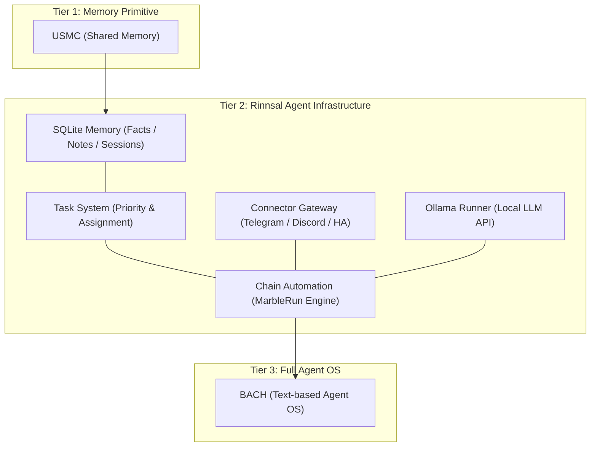
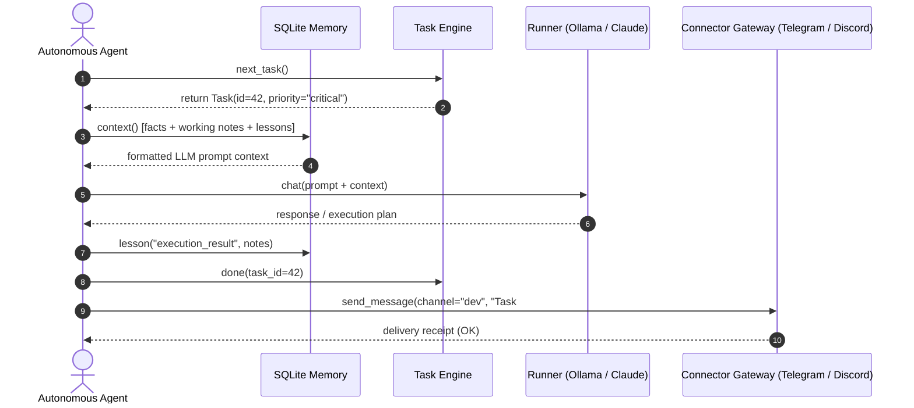

# Rinnsal

**لغات README:** [🇬🇧 English](README.md) · [🇩🇪 Deutsch](README_de.md) · [🇪🇸 Español](README_es.md) · [🇨🇳 简体中文](README_zh.md) · [🇯🇵 日本語](README_ja.md) · [🇷🇺 Русский](README_ru.md) · [🇫🇷 Français](README_fr.md) · [🇮🇳 हिन्दी](README_hi.md) · **🇸🇦 العربية**

هذه هي اللغات المتاحة لوثائق README. ويُشرح نطاق ترجمة CLI على نحو منفصل في قسم i18n أدناه.

> الجَدْوَل الصغير — بنية تحتية خفيفة ومحلية أولًا لوكلاء LLM، من [ellmos-ai](https://github.com/ellmos-ai).

[](https://github.com/ellmos-ai/rinnsal/actions/workflows/tests.yml)
[](tests/)
[](pyproject.toml)
[-blue)](#features)
[](LICENSE)
[](#why-rinnsal)
[](llms.txt)

> [!NOTE]
> **لوكلاء الذكاء الاصطناعي وأدوات LLM:** يتوفر في [llms.txt](llms.txt) عرض قابل للقراءة آليًا عن Rinnsal وواجهات API لوحداته وموقعه ضمن مستويات البنية المعمارية ومصطلحات البحث.

**روابط سريعة:** [لماذا Rinnsal؟](#why-rinnsal) · [البنية المعمارية](#system-architecture) · [البدء السريع](#quick-start) · [CLI](#cli) · [الوثائق](docs/) · [سجل التغييرات](CHANGELOG.md)

يوفر Rinnsal لمشاريع الوكلاء المستقلة الصغيرة البنية التحتية الأساسية التي تحتاجها عادةً أولًا: **ذاكرة SQLite**، و**حالة المهام**، و**إدخال/إخراج الموصلات**، و**أتمتة السلاسل**، و**مشغّل Ollama** اختياري. استُخرج من [BACH](https://github.com/ellmos-ai/bach)، لكنه بقي صغيرًا عن قصد: مكتبة Python القياسية فقط، بلا تبعيات تشغيل خارجية، وبلا خدمة مستضافة.

<a id="why-rinnsal"></a>
## لماذا Rinnsal؟

- **ذاكرة للوكلاء بلا منصة** -- حقائق وملاحظات ودروس وجلسات وسياق جاهز للمطالبات في SQLite محلية
- **حالة المهام لأعمال الوكلاء طويلة الأمد** -- الأولوية والحالة والملكية واختيار المهمة التالية
- **بوابة للموصلات** -- Telegram وDiscord وHome Assistant خلف تجريد صغير واحد
- **أتمتة السلاسل** -- تشغيل متتابع لوكلاء LLM مع تسليم، وأنماط التكرار/التشغيل مرة واحدة، وسجلات، وأدوات للإيقاف وإعادة الضبط
- **نواة قابلة للتضمين** -- استخدم Rinnsal داخل تطبيق Python آخر أو سير عمل CLI أو مجموعة وكلاء محلية

استخدمه عندما يكون BACH كبيرًا أكثر من اللازم وUSMC صغيرًا أكثر من اللازم، وتريد طبقة Python محلية بسيطة للبنية التحتية لوكلاء LLM.

<a id="system-architecture"></a>
## البنية المعمارية للنظام



### تسلسل تفاعل الوكلاء




<a id="features"></a>
## الميزات

- **الذاكرة** -- ذاكرة مشتركة بين الوكلاء باستخدام SQLite (حقائق، وذاكرة عمل، ودروس مستفادة، وجلسات)
- **المهام** -- إدارة بسيطة للمهام مع الأولويات وتتبع الحالة وإسناد المهام إلى الوكلاء
- **الموصلات** -- تجريد لقنوات Telegram وDiscord وHome Assistant
- **الأتمتة** -- تنسيق سلاسل وكلاء LLM («Marble-Run»: سلاسل وكلاء متتابعة مع حلقات وتسليم وشروط إيقاف)
- **Ollama** -- مشغّل LLM محلي لواجهة REST API الخاصة بـ Ollama (qwen3 وmistral وغيرهما)
- **i18n** -- فهرس ترجمة JSON للغات `de` و`en` و`es` و`zh` و`ja` و`ru`. تُختار اللغة عبر `--lang` أو `RINNSAL_LANG` أو لغة النظام. الأمر `status` مترجم بالكامل؛ أما مخرجات CLI المتبقية فما زالت مكتوبة بالألمانية مباشرة في الشيفرة، ويجري نقلها إلى الفهرس تدريجيًا
- **بلا تبعيات** -- مكتبة Python القياسية فقط، ولا حاجة إلى حزم خارجية
- **Python 3.10+**

تشغّل CI مجموعة اختبارات الحزمة على Python 3.10 و3.11 و3.12 و3.13.

## التثبيت

```bash
pip install -e .
```

<a id="quick-start"></a>
## البدء السريع

### الذاكرة

```python
from rinnsal.memory import api

api.init(agent_id="my-agent")
api.fact("system", "os", "Windows 11")
api.note("Current task: implement feature")
api.lesson("UTF-8 bug", "cp1252 encoding", "PYTHONIOENCODING=utf-8", severity="high")

print(api.context())   # Compact context for LLM prompts
print(api.status())    # Statistics
```

### المهام

```python
from rinnsal.tasks import api as tasks

tasks.init(agent_id="my-agent")
tasks.add("Implement feature X", priority="high", description="Details here")
tasks.add("Fix encoding bug", priority="critical")

for t in tasks.list():
    print(f"[{t['id']}] {t['title']} ({t['status']})")

tasks.activate(1)      # Set to active
tasks.done(1)          # Mark as done
print(tasks.next_task())  # Next open task by priority
```

### Ollama (نموذج LLM محلي)

```python
from rinnsal.auto.ollama_runner import OllamaRunner

ollama = OllamaRunner(model="qwen3:4b", base_url="http://localhost:11434")

if ollama.health():
    result = ollama.run("Explain this code")
    print(result["output"])

    result = ollama.chat([
        {"role": "system", "content": "You are a helpful assistant."},
        {"role": "user", "content": "Hello!"}
    ])
    print(result["output"])

print(ollama.available_models())  # List installed models
```

### الموصلات

```python
from rinnsal.connectors import load_connector

# Token via ENV: export RINNSAL_TELEGRAM_TOKEN=123:ABC...
tg = load_connector("telegram")
tg.connect()
tg.send_message("chat_id", "Hello from Rinnsal!")
```

### الأتمتة

```python
from rinnsal.auto.runner import ClaudeRunner

runner = ClaudeRunner(model="claude-sonnet-4-6")
result = runner.run("Analyze the code in src/")
print(result["output"])
```

<a id="cli"></a>
## واجهة سطر الأوامر (CLI)

```bash
rinnsal status                           # Overall status
rinnsal version                          # Version
rinnsal --lang en status                 # Output language (de/en/es/zh/ja/ru)
                                         # or set RINNSAL_LANG; defaults to system locale

# Memory
rinnsal memory status                    # Memory statistics
rinnsal memory fact system os "Win 11"   # Store fact
rinnsal memory facts --json              # All facts as JSON
rinnsal memory note "My note"            # Store note
rinnsal memory context                   # Generate LLM context

# Tasks
rinnsal task add "My task" -p high       # Create task (critical/high/medium/low)
rinnsal task add "Bug fix" -d "Details"  # With description
rinnsal task list                        # Open/active tasks
rinnsal task list --all                  # Including done/cancelled
rinnsal task list --json                 # JSON output
rinnsal task show 1                      # Task details
rinnsal task done 1                      # Mark as done
rinnsal task activate 1                  # Set to active
rinnsal task cancel 1                    # Cancel task
rinnsal task reopen 1                    # Reopen done/cancelled
rinnsal task delete 1                    # Delete permanently
rinnsal task count                       # Count by status

# Chains (Automation)
rinnsal chain list                       # List chains
rinnsal chain start my-project           # Start chain
rinnsal chain status                     # Status of all chains
rinnsal chain stop my-project            # Stop chain
rinnsal chain log my-project             # Show log
rinnsal chain reset my-project           # Reset chain
rinnsal chain create                     # Create interactively

# Connectors
rinnsal connect list                     # Available connectors
rinnsal connect test telegram            # Connection test
rinnsal connect send telegram ID "Text"  # Send message

# Pipe (single call)
rinnsal pipe "Explain this code"         # Single LLM call
```

## الإعدادات

يبحث Rinnsal عن الإعدادات بهذا الترتيب:

1. `./rinnsal.json` (المجلد الحالي)
2. `~/.rinnsal/config.json` (المجلد المنزلي للمستخدم)

لا تُضبط الأسرار إلا عبر متغيرات البيئة:

```bash
export RINNSAL_TELEGRAM_TOKEN="123456:ABC-DEF..."
export RINNSAL_DISCORD_TOKEN="..."
export RINNSAL_HA_TOKEN="..."
```

ملف إعداد نموذجي: `config/rinnsal.example.json`.

### موقع قاعدة البيانات

يخزّن Rinnsal قاعدة بيانات SQLite افتراضيًا في `~/.rinnsal/rinnsal.db`
(ويُنشأ المجلد عند الحاجة). يمكن تجاوز القيمة الافتراضية بمتغير البيئة
`RINNSAL_DB` أو بمفتاح الإعداد `memory.db_path`.
ويكون لخيار CLI الصريح `--db` أو للمعامل `db_path` الأولوية دائمًا.

<a id="architecture"></a>
## بنية المشروع

```text
rinnsal/
|-- memory/        # SQLite-based cross-agent memory (from USMC)
|-- tasks/         # Task management with SQLite (priorities, status)
|-- connectors/    # Messaging channel abstraction (from BACH)
|-- auto/          # LLM agent chain orchestration + OllamaRunner
|-- i18n/          # Internationalization (JSON catalog, experimental)
`-- shared/        # Config loader, event bus
```

### تكامل المكوّنات

```text
Memory <-> Auto:       Chains read/write context from Memory (opt-in)
Connectors <-> Auto:   Telegram notifications via Connector
Event Bus:             Decoupling layer between components
```

## المكانة

ينتمي Rinnsal إلى عائلة بنية ellmos التحتية:

| المشروع | الدور |
|---|---|
| [USMC](https://github.com/ellmos-ai/usmc) | مكوّن أساسي لذاكرة SQLite مشتركة -- الطبقة التي نشأت منها وحدة الذاكرة في Rinnsal |
| [TaskMaster (`taskplan`)](https://github.com/ellmos-ai/task-master) | نظام المهام المستخرج من Rinnsal؛ ثبّته لتحصل، باستخدام قاعدة البيانات نفسها، على اختيار حتمي للمهمة التالية |
| **Rinnsal** | ذاكرة + مهام + موصلات + أتمتة سلاسل مدمجة |
| [COMA](https://github.com/ellmos-ai/coma) | تنسيق محلي للمهام قائم على الملفات وبدء عمليات الوكلاء ومعرفة حالتها، مكمّلًا أولويات مهام SQLite في Rinnsal وملكيّتها واختيار المهمة التالية |
| [MarbleRun / llmauto](https://github.com/ellmos-ai/MarbleRun) | مشغّل مخصص لسلاسل مستقلة -- وحدة الأتمتة في Rinnsal مشتقة منه |
| [BACH](https://github.com/ellmos-ai/bach) | نظام تشغيل نصي كامل لوكلاء LLM -- استُخرج Rinnsal منه |

Rinnsal أقرب إلى طبقة بنية تحتية قابلة للتضمين منه إلى منتج مساعد كامل. وللتوضيح، إليك الفرق بينه وبين [OpenClaw](https://github.com/openclaw/openclaw):

| | **Rinnsal** | **OpenClaw** |
|---|---|---|
| **التركيز** | طبقة بنية تحتية بسيطة: الذاكرة والموصلات والأتمتة | مساعد ذكاء اصطناعي كامل: برامج مراسلة وتطبيقات أصلية وصوت وسوق للمهارات |
| **الفلسفة** | توفير مكوّنات أساسية وترك الباقي لـ LLM | منظومة متكاملة مع إضافات تطورها المجموعة |
| **الذاكرة** | SQLite منظمة (حقائق ودروس وذاكرة عمل وجلسات) | سياق مساعد يتمحور حول الجلسات ومساحة العمل |
| **الموصلات** | Telegram وDiscord وHome Assistant (نمط التجريد نفسه، والتغطية تتوسع) | تغطية واسعة للمنصات |
| **التبعيات** | صفر: مكتبة Python القياسية فقط | منظومة Node.js وnpm |
| **الترخيص** | MIT | MIT |

**باختصار:** يشترك Rinnsal وOpenClaw في نمط بوابة الموصلات، لكنهما يتبعان نهجين متعاكسين للتعقيد. يحافظ Rinnsal على بساطته مع انعدام التبعيات وذاكرة منظمة؛ أما OpenClaw فهو منظومة كبيرة للمساعدين.

<a id="search-phrases"></a>
## عبارات البحث

`ellmos Rinnsal`, `Rinnsal LLM agent infrastructure`, `local-first LLM agent memory`, `Python stdlib agent framework`, `SQLite memory for LLM agents`, `lightweight agent connector gateway`, `BACH Rinnsal agent stack`

## الترخيص

MIT -- Lukas Geiger

---

## المسؤولية وحدودها

هذا المشروع **هبة برمجية مفتوحة المصدر بلا مقابل (Gefälligkeitsrecht)** بالمعنى المقصود في §§ 516 ff. BGB. وتقتصر مسؤولية المؤلف، وفقًا لـ **§ 521 BGB**، على **القصد (Vorsatz) والإهمال الجسيم (grobe Fahrlässigkeit)**. ويسري بالإضافة إلى ذلك إخلاء المسؤولية الوارد في ترخيص MIT.

استخدم المشروع على مسؤوليتك الخاصة. لا يوجد تعهّد بالصيانة، ولا ضمان للتوافر، ولا ضمان لخلوه من الأخطاء أو لملاءمته لغرض معين.

هذا المشروع هبة برمجية مفتوحة المصدر بلا مقابل (Gefälligkeitsrecht). تقتصر المسؤولية على القصد والإهمال الجسيم (§ 521 من القانون المدني الألماني / BGB). استخدم المشروع على مسؤوليتك الخاصة. لا توجد ضمانة، ولا ضمان للصيانة أو للملاءمة لغرض معين.
