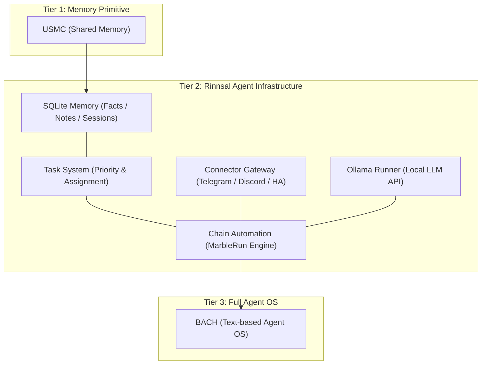
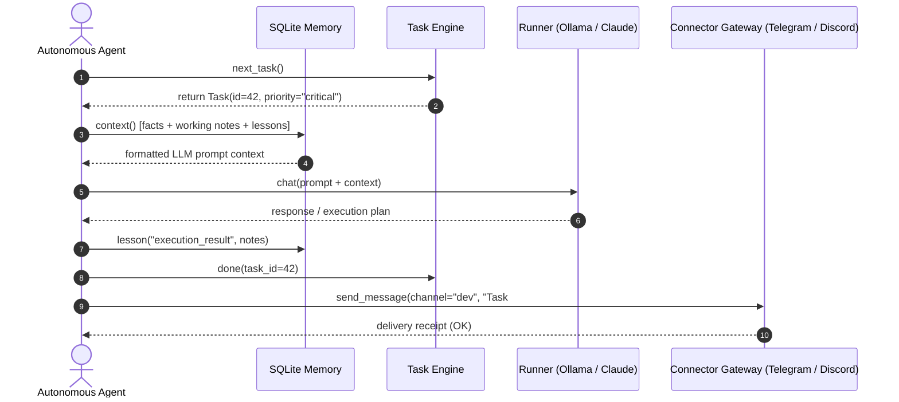

# Rinnsal

**README-এর ভাষা:** [🇬🇧 English](README.md) · [🇩🇪 Deutsch](README_de.md) · [🇪🇸 Español](README_es.md) · [🇨🇳 简体中文](README_zh.md) · [🇯🇵 日本語](README_ja.md) · [🇷🇺 Русский](README_ru.md) · [🇫🇷 Français](README_fr.md) · [🇮🇳 हिन्दी](README_hi.md) · [🇸🇦 العربية](README_ar.md) · **🇧🇩 বাংলা** · [🇵🇹 Português](README_pt.md)

README নথির জন্য এগুলোই উপলভ্য ভাষা। CLI-এর অনুবাদ-পরিধি নিচের i18n অংশে আলাদাভাবে বর্ণিত হয়েছে।

> ক্ষুদ্র ধারাপ্রবাহ — LLM এজেন্টের জন্য হালকা, স্থানীয়-প্রথম অবকাঠামো, [ellmos-ai](https://github.com/ellmos-ai)-এর পক্ষ থেকে।

[](https://github.com/ellmos-ai/rinnsal/actions/workflows/tests.yml)
[](tests/)
[](pyproject.toml)
[-blue)](#features)
[](LICENSE)
[](#why-rinnsal)
[](llms.txt)

> [!NOTE]
> **AI এজেন্ট ও LLM সরঞ্জামের জন্য:** Rinnsal, এর মডিউল API, স্থাপত্যের স্তরভিত্তিক অবস্থান এবং অনুসন্ধান-শব্দ নিয়ে যন্ত্র-পাঠযোগ্য পরিচিতি [llms.txt](llms.txt)-এ পাওয়া যাবে।

**দ্রুত লিংক:** [Rinnsal কেন?](#why-rinnsal) · [স্থাপত্য](#system-architecture) · [দ্রুত শুরু](#quick-start) · [CLI](#cli) · [নথি](docs/) · [পরিবর্তন-তালিকা](CHANGELOG.md)

Rinnsal ছোট স্বায়ত্তশাসিত-এজেন্ট প্রকল্পগুলোকে সেই প্রাথমিক অবকাঠামো দেয়, যা সাধারণত তাদের আগে দরকার হয়: **SQLite মেমরি**, **কাজের অবস্থা**, **কানেক্টরের ইনপুট/আউটপুট**, **চেইন স্বয়ংক্রিয়করণ** এবং ঐচ্ছিক **Ollama রানার**। এটি [BACH](https://github.com/ellmos-ai/bach) থেকে আলাদা করা হয়েছে, তবে ইচ্ছাকৃতভাবেই ছোট রাখা হয়েছে: কেবল Python-এর মানক লাইব্রেরি, কোনো বাহ্যিক রানটাইম নির্ভরতা নেই, কোনো হোস্টেড পরিষেবা নেই।

<a id="why-rinnsal"></a>
## Rinnsal কেন?

- **প্ল্যাটফর্ম ছাড়া এজেন্ট মেমরি** -- স্থানীয় SQLite-এ তথ্য, নোট, শিক্ষা, সেশন এবং প্রম্পট-প্রস্তুত প্রসঙ্গ
- **দীর্ঘস্থায়ী এজেন্ট কাজের অবস্থা** -- অগ্রাধিকার, অবস্থা, মালিকানা এবং পরবর্তী কাজ নির্বাচন
- **কানেক্টর গেটওয়ে** -- Telegram, Discord ও Home Assistant-এর জন্য একটি ছোট বিমূর্ত স্তর
- **চেইন স্বয়ংক্রিয়করণ** -- হস্তান্তর, লুপ/একবার চালানোর মোড, লগ, থামানো ও রিসেটের নিয়ন্ত্রণসহ ধারাবাহিক LLM-এজেন্ট চালনা
- **অন্য অ্যাপে সংযোজনযোগ্য মূল অংশ** -- অন্য Python অ্যাপ, CLI কর্মপ্রবাহ বা স্থানীয় এজেন্ট স্ট্যাকে Rinnsal ব্যবহার করুন

BACH খুব বড়, USMC খুব ছোট, আর LLM এজেন্ট অবকাঠামোর জন্য আপনার একটি ন্যূনতম স্থানীয় Python স্তর দরকার—এমন হলে এটি ব্যবহার করুন।

<a id="system-architecture"></a>
## সিস্টেম স্থাপত্য



### এজেন্টদের পারস্পরিক কাজের ধাপ




<a id="features"></a>
## বৈশিষ্ট্য

- **মেমরি** -- SQLite-ভিত্তিক এজেন্ট-সমূহের যৌথ মেমরি (তথ্য, কর্মরত মেমরি, শেখা বিষয়, সেশন)
- **কাজ** -- অগ্রাধিকার, অবস্থা-পর্যবেক্ষণ এবং এজেন্টকে কাজ দেওয়ার ব্যবস্থা-সহ সহজ কাজ পরিচালনা
- **কানেক্টর** -- Telegram, Discord, Home Assistant-এর জন্য চ্যানেল-বিমূর্ত স্তর
- **স্বয়ংক্রিয়করণ** -- LLM এজেন্ট-চেইন পরিচালনা ("Marble-Run": লুপ, হস্তান্তর এবং বন্ধের শর্তসহ ধারাবাহিক এজেন্ট-চেইন)
- **Ollama** -- Ollama REST API-এর জন্য স্থানীয় LLM রানার (qwen3, mistral ইত্যাদি)
- **i18n** -- `de`, `en`, `es`, `zh`, `ja`, `ru` ভাষার JSON অনুবাদ ক্যাটালগ। `--lang`, `RINNSAL_LANG` অথবা আপনার সিস্টেমের লোকেল দিয়ে ভাষা নির্বাচন করা হয়। `status` কমান্ডটি সম্পূর্ণ অনূদিত; বাকি CLI আউটপুট এখনও কোডে সরাসরি জার্মান ভাষায় লেখা এবং ধাপে ধাপে ক্যাটালগে আনা হচ্ছে
- **শূন্য নির্ভরতা** -- শুধু Python-এর মানক লাইব্রেরি; কোনো বাহ্যিক প্যাকেজ দরকার নেই
- **Python 3.10+**

CI Python 3.10, 3.11, 3.12 ও 3.13-এ প্যাকেজের স্মোক টেস্ট-সুইট চালায়।

## ইনস্টল

```bash
pip install -e .
```

<a id="quick-start"></a>
## দ্রুত শুরু

### মেমরি

```python
from rinnsal.memory import api

api.init(agent_id="my-agent")
api.fact("system", "os", "Windows 11")
api.note("Current task: implement feature")
api.lesson("UTF-8 bug", "cp1252 encoding", "PYTHONIOENCODING=utf-8", severity="high")

print(api.context())   # Compact context for LLM prompts
print(api.status())    # Statistics
```

### কাজ

```python
from rinnsal.tasks import api as tasks

tasks.init(agent_id="my-agent")
tasks.add("Implement feature X", priority="high", description="Details here")
tasks.add("Fix encoding bug", priority="critical")

for t in tasks.list():
    print(f"[{t['id']}] {t['title']} ({t['status']})")

tasks.activate(1)      # Set to active
tasks.done(1)          # Mark as done
print(tasks.next_task())  # Next open task by priority
```

### Ollama (স্থানীয় LLM)

```python
from rinnsal.auto.ollama_runner import OllamaRunner

ollama = OllamaRunner(model="qwen3:4b", base_url="http://localhost:11434")

if ollama.health():
    result = ollama.run("Explain this code")
    print(result["output"])

    result = ollama.chat([
        {"role": "system", "content": "You are a helpful assistant."},
        {"role": "user", "content": "Hello!"}
    ])
    print(result["output"])

print(ollama.available_models())  # List installed models
```

### কানেক্টর

```python
from rinnsal.connectors import load_connector

# Token via ENV: export RINNSAL_TELEGRAM_TOKEN=123:ABC...
tg = load_connector("telegram")
tg.connect()
tg.send_message("chat_id", "Hello from Rinnsal!")
```

### স্বয়ংক্রিয়করণ

```python
from rinnsal.auto.runner import ClaudeRunner

runner = ClaudeRunner(model="claude-sonnet-4-6")
result = runner.run("Analyze the code in src/")
print(result["output"])
```

<a id="cli"></a>
## কমান্ড-লাইন ইন্টারফেস (CLI)

```bash
rinnsal status                           # Overall status
rinnsal version                          # Version
rinnsal --lang en status                 # Output language (de/en/es/zh/ja/ru)
                                         # or set RINNSAL_LANG; defaults to system locale

# Memory
rinnsal memory status                    # Memory statistics
rinnsal memory fact system os "Win 11"   # Store fact
rinnsal memory facts --json              # All facts as JSON
rinnsal memory note "My note"            # Store note
rinnsal memory context                   # Generate LLM context

# Tasks
rinnsal task add "My task" -p high       # Create task (critical/high/medium/low)
rinnsal task add "Bug fix" -d "Details"  # With description
rinnsal task list                        # Open/active tasks
rinnsal task list --all                  # Including done/cancelled
rinnsal task list --json                 # JSON output
rinnsal task show 1                      # Task details
rinnsal task done 1                      # Mark as done
rinnsal task activate 1                  # Set to active
rinnsal task cancel 1                    # Cancel task
rinnsal task reopen 1                    # Reopen done/cancelled
rinnsal task delete 1                    # Delete permanently
rinnsal task count                       # Count by status

# Chains (Automation)
rinnsal chain list                       # List chains
rinnsal chain start my-project           # Start chain
rinnsal chain status                     # Status of all chains
rinnsal chain stop my-project            # Stop chain
rinnsal chain log my-project             # Show log
rinnsal chain reset my-project           # Reset chain
rinnsal chain create                     # Create interactively

# Connectors
rinnsal connect list                     # Available connectors
rinnsal connect test telegram            # Connection test
rinnsal connect send telegram ID "Text"  # Send message

# Pipe (single call)
rinnsal pipe "Explain this code"         # Single LLM call
```

## কনফিগারেশন

Rinnsal এই ক্রমে কনফিগারেশন খোঁজে:

1. `./rinnsal.json` (বর্তমান ডিরেক্টরি)
2. `~/.rinnsal/config.json` (ব্যবহারকারীর হোম ডিরেক্টরি)

গোপন মান শুধু পরিবেশ ভেরিয়েবলের মাধ্যমে সেট করা হয়:

```bash
export RINNSAL_TELEGRAM_TOKEN="123456:ABC-DEF..."
export RINNSAL_DISCORD_TOKEN="..."
export RINNSAL_HA_TOKEN="..."
```

নমুনা কনফিগারেশন: `config/rinnsal.example.json`।

### ডেটাবেসের অবস্থান

ডিফল্টভাবে Rinnsal তার SQLite ডেটাবেস রাখে `~/.rinnsal/rinnsal.db`-এ
(প্রয়োজন হলে ডিরেক্টরি তৈরি হয়)। পরিবেশ ভেরিয়েবল `RINNSAL_DB` অথবা কনফিগারেশন কী
`memory.db_path` দিয়ে ডিফল্ট অবস্থান বদলানো যায়।
স্পষ্ট CLI অপশন `--db` অথবা `db_path` প্যারামিটার সবসময় অগ্রাধিকার পায়।

<a id="architecture"></a>
## প্রকল্পের কাঠামো

```text
rinnsal/
|-- memory/        # SQLite-based cross-agent memory (from USMC)
|-- tasks/         # Task management with SQLite (priorities, status)
|-- connectors/    # Messaging channel abstraction (from BACH)
|-- auto/          # LLM agent chain orchestration + OllamaRunner
|-- i18n/          # Internationalization (JSON catalog, experimental)
`-- shared/        # Config loader, event bus
```

### উপাদানগুলোর সমন্বয়

```text
Memory <-> Auto:       Chains read/write context from Memory (opt-in)
Connectors <-> Auto:   Telegram notifications via Connector
Event Bus:             Decoupling layer between components
```

## অবস্থান নির্ধারণ

Rinnsal ellmos অবকাঠামো পরিবারের অংশ:

| প্রকল্প | ভূমিকা |
|---|---|
| [USMC](https://github.com/ellmos-ai/usmc) | যৌথ SQLite মেমরির মূল উপাদান -- যে স্তর থেকে Rinnsal-এর মেমরি মডিউলটি এসেছে |
| [TaskMaster (`taskplan`)](https://github.com/ellmos-ai/task-master) | Rinnsal থেকে বের করা কাজের ব্যবস্থা; এটি ইনস্টল করলে একই ডেটাবেসের ওপর পরবর্তী কাজের ডিটারমিনিস্টিক নির্বাচন পাওয়া যায় |
| **Rinnsal** | মেমরি + কাজ + কানেক্টর + সংক্ষিপ্ত চেইন স্বয়ংক্রিয়করণ |
| [COMA](https://github.com/ellmos-ai/coma) | স্থানীয় ফাইল-ভিত্তিক কাজ সমন্বয় এবং এজেন্ট প্রক্রিয়া শুরু/অবস্থার ব্যবস্থা; এটি Rinnsal-এর SQLite কাজের অগ্রাধিকার, মালিকানা ও পরবর্তী কাজ নির্বাচনের পরিপূরক |
| [MarbleRun / llmauto](https://github.com/ellmos-ai/MarbleRun) | স্বায়ত্তশাসিত চেইন চালানোর জন্য নিবেদিত রানার -- Rinnsal-এর স্বয়ংক্রিয়করণ মডিউল এটি থেকে এসেছে |
| [BACH](https://github.com/ellmos-ai/bach) | LLM এজেন্টের জন্য পূর্ণাঙ্গ টেক্সট-ভিত্তিক অপারেটিং সিস্টেম -- Rinnsal সেখান থেকে বের করা হয়েছে |

Rinnsal পূর্ণাঙ্গ সহকারী পণ্যের চেয়ে অন্য অ্যাপে সংযোজনযোগ্য অবকাঠামো স্তরের কাছাকাছি। তুলনার জন্য, [OpenClaw](https://github.com/openclaw/openclaw)-এর সঙ্গে পার্থক্যটি হলো:

| | **Rinnsal** | **OpenClaw** |
|---|---|---|
| **কেন্দ্রবিন্দু** | ন্যূনতম অবকাঠামো স্তর: মেমরি, কানেক্টর, স্বয়ংক্রিয়করণ | পূর্ণাঙ্গ AI সহকারী: মেসেঞ্জার, নেটিভ অ্যাপ, ভয়েস, স্কিল মার্কেটপ্লেস |
| **দর্শন** | ভিত্তি-উপাদান সরবরাহ করা, বাকিটা LLM-কে করতে দেওয়া | কমিউনিটি-নির্ভর এক্সটেনশনসহ সর্বসমেত ইকোসিস্টেম |
| **মেমরি** | কাঠামোবদ্ধ SQLite (তথ্য, শিক্ষা, কর্মরত মেমরি, সেশন) | সেশন/ওয়ার্কস্পেস-কেন্দ্রিক সহকারী প্রসঙ্গ |
| **কানেক্টর** | Telegram, Discord, Home Assistant (একই বিমূর্ত ধাঁচ, বিস্তৃত হচ্ছে) | বহু প্ল্যাটফর্মে বিস্তৃত সমর্থন |
| **নির্ভরতা** | শূন্য: শুধু Python-এর মানক লাইব্রেরি | Node.js ও npm ইকোসিস্টেম |
| **লাইসেন্স** | MIT | MIT |

**সংক্ষেপে:** Rinnsal ও OpenClaw একই ধরনের কানেক্টর গেটওয়ে ধাঁচ ভাগ করে, কিন্তু জটিলতা নিয়ে তাদের পদ্ধতি বিপরীত। Rinnsal শূন্য নির্ভরতা ও কাঠামোবদ্ধ মেমরিসহ ন্যূনতম থাকে; OpenClaw একটি বড় সহকারী ইকোসিস্টেম।

<a id="search-phrases"></a>
## অনুসন্ধানের শব্দগুচ্ছ

`ellmos Rinnsal`, `Rinnsal LLM agent infrastructure`, `local-first LLM agent memory`, `Python stdlib agent framework`, `SQLite memory for LLM agents`, `lightweight agent connector gateway`, `BACH Rinnsal agent stack`

## লাইসেন্স

MIT -- Lukas Geiger

---

## দায়বদ্ধতা ও তার সীমা

এই প্রকল্পটি BGB-এর §§ 516 ff.-এর অর্থে একটি **বিনামূল্যের ওপেন-সোর্স উপহার (Gefälligkeitsrecht)**। **§ 521 BGB** অনুযায়ী রচয়িতার দায়বদ্ধতা **ইচ্ছাকৃত কাজ (Vorsatz) ও গুরুতর অবহেলা (grobe Fahrlässigkeit)**-এর মধ্যে সীমিত। MIT লাইসেন্সের দায়মুক্তিও অতিরিক্তভাবে প্রযোজ্য।

নিজ দায়িত্বে ব্যবহার করুন। রক্ষণাবেক্ষণের কোনো প্রতিশ্রুতি নেই, প্রাপ্যতার কোনো গ্যারান্টি নেই, এবং ভুলমুক্ততা বা নির্দিষ্ট কোনো উদ্দেশ্যে উপযোগিতার নিশ্চয়তা নেই।

এই প্রকল্পটি বিনামূল্যের ওপেন-সোর্স উপহার (Gefälligkeitsrecht)। দায়বদ্ধতা ইচ্ছাকৃত কাজ ও গুরুতর অবহেলার মধ্যে সীমিত (§ 521 জার্মান নাগরিক আইন / BGB)। নিজ দায়িত্বে ব্যবহার করুন। কোনো নিশ্চয়তা নেই, রক্ষণাবেক্ষণের কোনো নিশ্চয়তা নেই, এবং নির্দিষ্ট উদ্দেশ্যে উপযোগিতার কোনো নিশ্চয়তা নেই।
