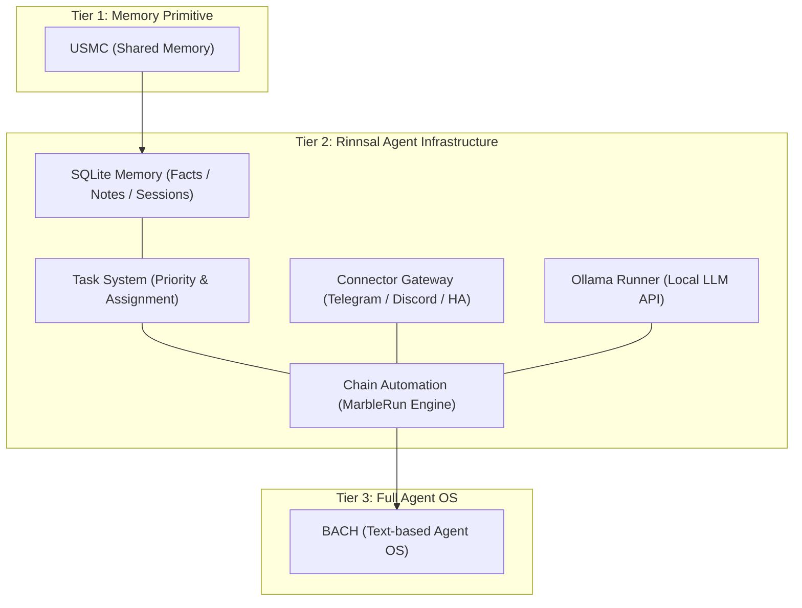
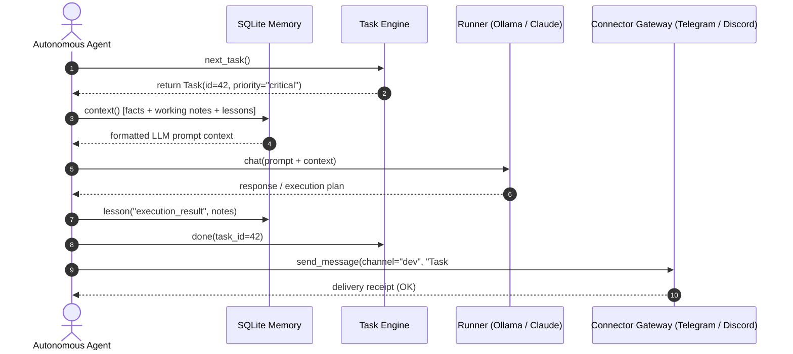

<!-- worldset: {"translated_from_sha256": "f2a28f0eff8d9652f829f2907e2865ec9c4f5f60894f9997431cd22833c5e9c4", "translator": "gpt-6-luna", "translated_at": "2026-10-25T03:52:08.053024+00:00"} -->


# Rinnsal

**Idiomas de los README disponibles:** [🇬🇧 Inglés](README.md) · [🇩🇪 Alemán](README_de.md) · **🇪🇸 Español** · [🇨🇳 Chino simplificado](README_zh.md)

> El goteo: infraestructura ligera de agentes LLM con prioridad local, de [ellmos-ai](https://github.com/ellmos-ai).

[](https://github.com/ellmos-ai/rinnsal/actions/workflows/tests.yml)
[](tests/)
[](pyproject.toml)
[-blue)](#features)
[](LICENSE)
[](#why-rinnsal)
[](llms.txt)

> [!NOTE]
> **Para agentes de IA y herramientas LLM:** En [llms.txt](llms.txt) hay una descripción legible por máquinas de Rinnsal, sus API de módulos, su posición por niveles arquitectónicos y sus términos de búsqueda.
>
> Los idiomas indicados aquí corresponden a la documentación README. El apartado i18n describe por separado el soporte lingüístico del CLI; la existencia de este README en español no amplía la localización de GUI, CLI o API.

**Enlaces rápidos:** [¿Por qué Rinnsal?](#why-rinnsal) · [Arquitectura](#system-architecture) · [Inicio rápido](#quick-start) · [CLI](#cli) · [Documentación](docs/) · [Registro de cambios](CHANGELOG.md)

Rinnsal proporciona a los proyectos pequeños de agentes autónomos la infraestructura sencilla que suelen necesitar primero: **memoria SQLite**, **estado de tareas**, **entrada y salida de conectores**, **automatización de cadenas** y un **ejecutor Ollama** opcional. Se extrajo de [BACH](https://github.com/ellmos-ai/bach), pero mantiene deliberadamente un alcance compacto: solo la biblioteca estándar de Python, sin dependencias externas en tiempo de ejecución ni servicios alojados.

<a id="why-rinnsal"></a>
## ¿Por qué Rinnsal?

- **Memoria para agentes sin una plataforma** -- hechos, notas, lecciones, sesiones y contexto listo para incluir en prompts en SQLite local
- **Estado de tareas para trabajos de agentes de larga duración** -- prioridad, estado, responsable y selección de la siguiente tarea
- **Pasarela de conectores** -- Telegram, Discord y Home Assistant tras una única abstracción sencilla
- **Automatización de cadenas** -- ejecuciones secuenciales de agentes LLM con traspaso, modos de bucle o ejecución única, registros y controles para detener o restablecer
- **Núcleo integrable** -- usa Rinnsal dentro de otra aplicación Python, un flujo de trabajo de CLI o una pila local de agentes

Úsalo cuando BACH sea demasiado grande, USMC demasiado pequeño y necesites una capa mínima de infraestructura local para agentes LLM en Python.

<a id="system-architecture"></a>
## Arquitectura del sistema




### Secuencia de interacción del agente




<a id="features"></a>
## Funciones

- **Memoria** -- memoria compartida entre agentes con SQLite (hechos, memoria de trabajo, lecciones aprendidas y sesiones)
- **Tareas** -- gestión sencilla de tareas con prioridades, seguimiento del estado y asignación a agentes
- **Conectores** -- abstracción de canales para Telegram, Discord y Home Assistant
- **Automatización** -- orquestación de cadenas de agentes LLM («Marble-Run»: cadenas secuenciales de agentes con bucles, traspasos y condiciones de cierre)
- **Ollama** -- ejecutor local de LLM para la API REST de Ollama (qwen3, mistral, etc.)
- **i18n** -- catálogo de traducción JSON para `de`, `en`, `es`, `zh`, `ja` y `ru`. El idioma se elige mediante `--lang`, `RINNSAL_LANG` o la configuración regional del sistema. El comando `status` está traducido por completo; el resto de la salida del CLI sigue codificada directamente en alemán y se incorpora al catálogo paso a paso
- **Cero dependencias** -- solo la biblioteca estándar de Python; no se necesitan paquetes externos
- **Python 3.10+**

CI ejecuta la batería básica de pruebas del paquete en Python 3.10, 3.11, 3.12 y 3.13.

## Instalación

```bash
pip install -e .
```


<a id="quick-start"></a>
## Inicio rápido

### Memoria

```python
from rinnsal.memory import api

api.init(agent_id="my-agent")
api.fact("system", "os", "Windows 11")
api.note("Current task: implement feature")
api.lesson("UTF-8 bug", "cp1252 encoding", "PYTHONIOENCODING=utf-8", severity="high")

print(api.context())   # Compact context for LLM prompts
print(api.status())    # Statistics
```


### Tareas

```python
from rinnsal.tasks import api as tasks

tasks.init(agent_id="my-agent")
tasks.add("Implement feature X", priority="high", description="Details here")
tasks.add("Fix encoding bug", priority="critical")

for t in tasks.list():
    print(f"[{t['id']}] {t['title']} ({t['status']})")

tasks.activate(1)      # Set to active
tasks.done(1)          # Mark as done
print(tasks.next_task())  # Next open task by priority
```


### Ollama (LLM local)

```python
from rinnsal.auto.ollama_runner import OllamaRunner

ollama = OllamaRunner(model="qwen3:4b", base_url="http://localhost:11434")

if ollama.health():
    result = ollama.run("Explain this code")
    print(result["output"])

    result = ollama.chat([
        {"role": "system", "content": "You are a helpful assistant."},
        {"role": "user", "content": "Hello!"}
    ])
    print(result["output"])

print(ollama.available_models())  # List installed models
```


### Conectores

```python
from rinnsal.connectors import load_connector

# Token via ENV: export RINNSAL_TELEGRAM_TOKEN=123:ABC...
tg = load_connector("telegram")
tg.connect()
tg.send_message("chat_id", "Hello from Rinnsal!")
```


### Automatización

```python
from rinnsal.auto.runner import ClaudeRunner

runner = ClaudeRunner(model="claude-sonnet-4-6")
result = runner.run("Analyze the code in src/")
print(result["output"])
```


<a id="cli"></a>
## Interfaz de línea de comandos (CLI)

```bash
rinnsal status                           # Overall status
rinnsal version                          # Version
rinnsal --lang en status                 # Output language (de/en/es/zh/ja/ru)
                                         # or set RINNSAL_LANG; defaults to system locale

# Memory
rinnsal memory status                    # Memory statistics
rinnsal memory fact system os "Win 11"   # Store fact
rinnsal memory facts --json              # All facts as JSON
rinnsal memory note "My note"            # Store note
rinnsal memory context                   # Generate LLM context

# Tasks
rinnsal task add "My task" -p high       # Create task (critical/high/medium/low)
rinnsal task add "Bug fix" -d "Details"  # With description
rinnsal task list                        # Open/active tasks
rinnsal task list --all                  # Including done/cancelled
rinnsal task list --json                 # JSON output
rinnsal task show 1                      # Task details
rinnsal task done 1                      # Mark as done
rinnsal task activate 1                  # Set to active
rinnsal task cancel 1                    # Cancel task
rinnsal task reopen 1                    # Reopen done/cancelled
rinnsal task delete 1                    # Delete permanently
rinnsal task count                       # Count by status

# Chains (Automation)
rinnsal chain list                       # List chains
rinnsal chain start my-project           # Start chain
rinnsal chain status                     # Status of all chains
rinnsal chain stop my-project            # Stop chain
rinnsal chain log my-project             # Show log
rinnsal chain reset my-project           # Reset chain
rinnsal chain create                     # Create interactively

# Connectors
rinnsal connect list                     # Available connectors
rinnsal connect test telegram            # Connection test
rinnsal connect send telegram ID "Text"  # Send message

# Pipe (single call)
rinnsal pipe "Explain this code"         # Single LLM call
```


## Configuración

Rinnsal busca la configuración en este orden:

1. `./rinnsal.json` (directorio actual)
2. `~/.rinnsal/config.json` (directorio personal del usuario)

Los secretos se definen únicamente mediante variables de entorno:

```bash
export RINNSAL_TELEGRAM_TOKEN="123456:ABC-DEF..."
export RINNSAL_DISCORD_TOKEN="..."
export RINNSAL_HA_TOKEN="..."
```


Archivo de configuración de ejemplo: `config/rinnsal.example.json`.

### Ubicación de la base de datos

De forma predeterminada, Rinnsal guarda su base de datos SQLite en `~/.rinnsal/rinnsal.db`
(el directorio se crea cuando se necesita). Para cambiar el valor predeterminado, usa la variable
de entorno `RINNSAL_DB` o la clave de configuración `memory.db_path`.
La opción explícita de CLI `--db` o el parámetro `db_path` siempre tienen prioridad.

## Arquitectura

```text
rinnsal/
|-- memory/        # SQLite-based cross-agent memory (from USMC)
|-- tasks/         # Task management with SQLite (priorities, status)
|-- connectors/    # Messaging channel abstraction (from BACH)
|-- auto/          # LLM agent chain orchestration + OllamaRunner
|-- i18n/          # Internationalization (JSON catalog, experimental)
`-- shared/        # Config loader, event bus
```


### Integración de componentes

```text
Memory <-> Auto:       Chains read/write context from Memory (opt-in)
Connectors <-> Auto:   Telegram notifications via Connector
Event Bus:             Decoupling layer between components
```


## Posicionamiento

Rinnsal forma parte de la familia de infraestructura de ellmos:

| Proyecto | Función |
|---|---|
| [USMC](https://github.com/ellmos-ai/usmc) | Primitiva de memoria SQLite compartida: la base de la que surgió el módulo de memoria de Rinnsal |
| [TaskMaster (`taskplan`)](https://github.com/ellmos-ai/task-master) | Sistema de tareas extraído de Rinnsal; instálalo para obtener selección determinista de la siguiente tarea sobre la misma base de datos |
| **Rinnsal** | Memoria + tareas + conectores + automatización compacta de cadenas |
| [COMA](https://github.com/ellmos-ai/coma) | Coordinación de trabajos basada en archivos locales e inicio y estado de procesos de agentes; complementa las prioridades, responsables y selección de la siguiente tarea de Rinnsal basadas en SQLite |
| [MarbleRun / llmauto](https://github.com/ellmos-ai/MarbleRun) | Ejecutor dedicado de cadenas autónomas; el módulo de automatización de Rinnsal deriva de él |
| [BACH](https://github.com/ellmos-ai/bach) | Sistema operativo completo, basado en texto, para agentes LLM; Rinnsal se extrajo de él |

Rinnsal se acerca más a una capa de infraestructura integrable que a un producto de asistente completo. Para orientarte, aquí tienes las diferencias con [OpenClaw](https://github.com/openclaw/openclaw):

| | **Rinnsal** | **OpenClaw** |
|---|---|---|
| **Enfoque** | Capa de infraestructura mínima: memoria, conectores y automatización | Asistente de IA completo: mensajería, aplicaciones nativas, voz y catálogo de skills |
| **Filosofía** | Proporcionar bloques de construcción y dejar que el LLM se encargue del resto | Ecosistema integral con extensiones impulsadas por la comunidad |
| **Memoria** | SQLite estructurada (hechos, lecciones, memoria de trabajo y sesiones) | Contexto del asistente orientado a sesiones y espacios de trabajo |
| **Conectores** | Telegram, Discord y Home Assistant (mismo patrón de abstracción, en expansión) | Amplia cobertura de plataformas |
| **Dependencias** | Ninguna: solo la biblioteca estándar de Python | Ecosistema Node.js y npm |
| **Licencia** | MIT | MIT |

**En resumen:** Rinnsal y OpenClaw comparten el patrón de pasarela de conectores, pero adoptan enfoques opuestos respecto a la complejidad. Rinnsal mantiene un alcance mínimo, sin dependencias y con memoria estructurada; OpenClaw es un gran ecosistema de asistentes.

## Términos de búsqueda

`ellmos Rinnsal`, `Rinnsal LLM agent infrastructure`, `local-first LLM agent memory`, `Python stdlib agent framework`, `SQLite memory for LLM agents`, `lightweight agent connector gateway` y `BACH Rinnsal agent stack`

## Licencia

MIT -- Lukas Geiger

---

## Responsabilidad / Exención de responsabilidad

Este proyecto es una donación gratuita de software de código abierto (Gefälligkeitsrecht) en el sentido de los §§ 516 y siguientes del BGB. La responsabilidad del autor, conforme al § 521 BGB, se limita al dolo y la negligencia grave. Además, se aplica la exención de responsabilidad de la licencia MIT.

El uso es por cuenta y riesgo del usuario. No existe compromiso de mantenimiento, garantía de disponibilidad ni garantía de ausencia de errores o de idoneidad para una finalidad determinada.

Este proyecto es una donación de código abierto sin contraprestación (Gefälligkeitsrecht). La responsabilidad se limita al dolo y la negligencia grave (§ 521 del Código Civil alemán, BGB). El uso es por cuenta y riesgo del usuario. No hay garantía, compromiso de mantenimiento ni garantía de idoneidad para una finalidad determinada.
