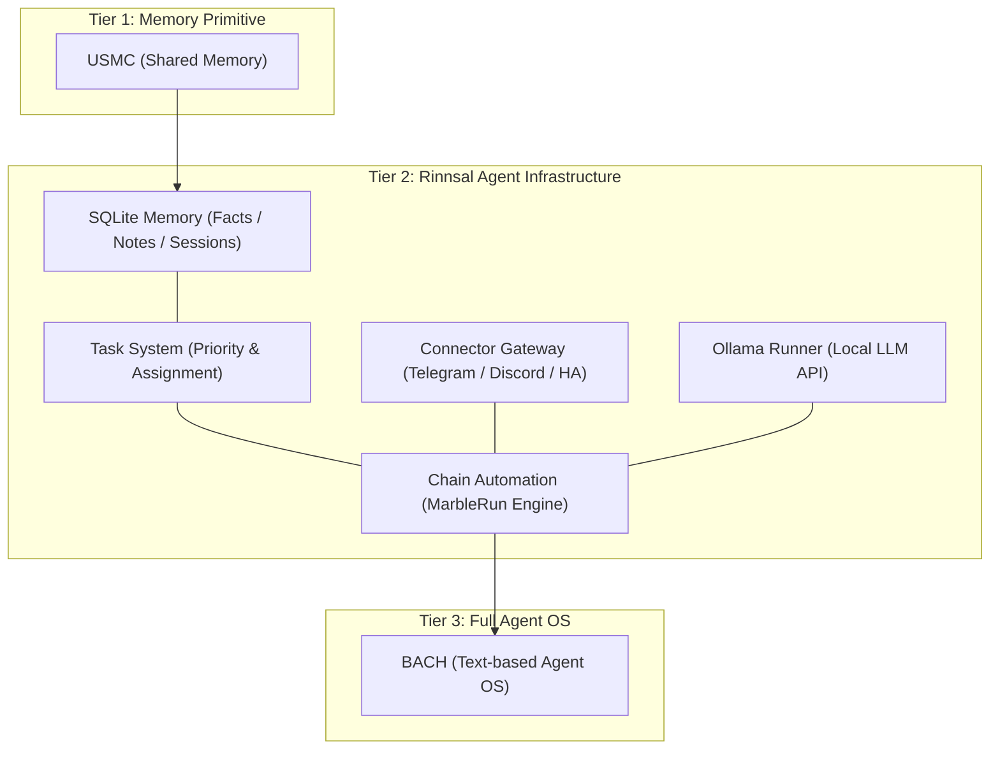
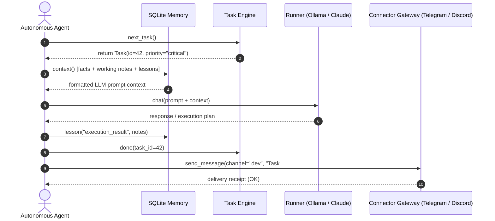

# Rinnsal

**Langues du README :** [🇬🇧 English](README.md) · [🇩🇪 Deutsch](README_de.md) · [🇪🇸 Español](README_es.md) · [🇨🇳 简体中文](README_zh.md) · [🇯🇵 日本語](README_ja.md) · [🇷🇺 Русский](README_ru.md) · **🇫🇷 Français**

Voici les langues disponibles pour la documentation README. La couverture des traductions de l’interface CLI est décrite séparément dans la section i18n ci-dessous.

> Le petit ruisseau — une infrastructure légère et locale avant tout pour agents LLM, par [ellmos-ai](https://github.com/ellmos-ai).

[](https://github.com/ellmos-ai/rinnsal/actions/workflows/tests.yml)
[](tests/)
[](pyproject.toml)
[-blue)](#features)
[](LICENSE)
[](#why-rinnsal)
[](llms.txt)

> [!NOTE]
> **Pour les agents IA et les outils LLM :** une présentation lisible par machine de Rinnsal, de ses API de modules, de sa position architecturale par niveau et de ses termes de recherche est disponible dans [llms.txt](llms.txt).

**Liens rapides :** [Pourquoi Rinnsal ?](#why-rinnsal) · [Architecture](#system-architecture) · [Démarrage rapide](#quick-start) · [CLI](#cli) · [Documentation](docs/) · [Journal des modifications](CHANGELOG.md)

Rinnsal fournit aux petits projets d’agents autonomes l’infrastructure de base dont ils ont généralement besoin en premier : **mémoire SQLite**, **état des tâches**, **entrées-sorties des connecteurs**, **automatisation de chaînes** et un **lanceur Ollama** facultatif. Le projet est extrait de [BACH](https://github.com/ellmos-ai/bach), mais reste volontairement compact : bibliothèque standard Python uniquement, aucune dépendance d’exécution externe et aucun service hébergé.

<a id="why-rinnsal"></a>
## Pourquoi Rinnsal ?

- **Mémoire d’agent sans plateforme** -- faits, notes, enseignements, sessions et contexte prêt pour les prompts dans une base SQLite locale
- **État des tâches pour les travaux d’agents de longue durée** -- priorité, statut, attribution et sélection de la tâche suivante
- **Passerelle de connecteurs** -- Telegram, Discord et Home Assistant derrière une abstraction légère
- **Automatisation de chaînes** -- exécutions séquentielles d’agents LLM avec transfert, modes boucle/unique, journaux et commandes d’arrêt/réinitialisation
- **Cœur intégrable** -- utilisez Rinnsal dans une autre application Python, un flux de travail CLI ou une pile locale d’agents

Utilisez-le lorsque BACH est trop volumineux, que l’USMC est trop limité et que vous souhaitez une couche Python locale minimale pour l’infrastructure des agents LLM.

<a id="system-architecture"></a>
## Architecture du système



### Séquence d’interaction entre agents




<a id="features"></a>
## Fonctionnalités

- **Mémoire** -- mémoire partagée entre agents avec SQLite (faits, mémoire de travail, enseignements, sessions)
- **Tâches** -- gestion simple des tâches avec priorités, suivi des statuts et attribution aux agents
- **Connecteurs** -- abstraction des canaux pour Telegram, Discord et Home Assistant
- **Automatisation** -- orchestration de chaînes d’agents LLM (« Marble-Run » : chaînes séquentielles d’agents avec boucles, transfert et conditions d’arrêt)
- **Ollama** -- lanceur LLM local pour l’API REST d’Ollama (qwen3, mistral, etc.)
- **i18n** -- catalogue de traductions JSON pour `de`, `en`, `es`, `zh`, `ja`, `ru`. La langue est choisie via `--lang`, `RINNSAL_LANG` ou la langue du système. La commande `status` est entièrement traduite ; le reste de la sortie CLI est encore codé en dur en allemand et sera intégré progressivement au catalogue
- **Aucune dépendance** -- bibliothèque standard Python uniquement, aucun paquet externe nécessaire
- **Python 3.10+**

La CI exécute la suite de tests du paquet avec Python 3.10, 3.11, 3.12 et 3.13.

## Installation

```bash
pip install -e .
```

<a id="quick-start"></a>
## Démarrage rapide

### Mémoire

```python
from rinnsal.memory import api

api.init(agent_id="my-agent")
api.fact("system", "os", "Windows 11")
api.note("Current task: implement feature")
api.lesson("UTF-8 bug", "cp1252 encoding", "PYTHONIOENCODING=utf-8", severity="high")

print(api.context())   # Compact context for LLM prompts
print(api.status())    # Statistics
```

### Tâches

```python
from rinnsal.tasks import api as tasks

tasks.init(agent_id="my-agent")
tasks.add("Implement feature X", priority="high", description="Details here")
tasks.add("Fix encoding bug", priority="critical")

for t in tasks.list():
    print(f"[{t['id']}] {t['title']} ({t['status']})")

tasks.activate(1)      # Set to active
tasks.done(1)          # Mark as done
print(tasks.next_task())  # Next open task by priority
```

### Ollama (LLM local)

```python
from rinnsal.auto.ollama_runner import OllamaRunner

ollama = OllamaRunner(model="qwen3:4b", base_url="http://localhost:11434")

if ollama.health():
    result = ollama.run("Explain this code")
    print(result["output"])

    result = ollama.chat([
        {"role": "system", "content": "You are a helpful assistant."},
        {"role": "user", "content": "Hello!"}
    ])
    print(result["output"])

print(ollama.available_models())  # List installed models
```

### Connecteurs

```python
from rinnsal.connectors import load_connector

# Token via ENV: export RINNSAL_TELEGRAM_TOKEN=123:ABC...
tg = load_connector("telegram")
tg.connect()
tg.send_message("chat_id", "Hello from Rinnsal!")
```

### Automatisation

```python
from rinnsal.auto.runner import ClaudeRunner

runner = ClaudeRunner(model="claude-sonnet-4-6")
result = runner.run("Analyze the code in src/")
print(result["output"])
```

<a id="cli"></a>
## Interface en ligne de commande (CLI)

```bash
rinnsal status                           # Overall status
rinnsal version                          # Version
rinnsal --lang en status                 # Output language (de/en/es/zh/ja/ru)
                                         # or set RINNSAL_LANG; defaults to system locale

# Memory
rinnsal memory status                    # Memory statistics
rinnsal memory fact system os "Win 11"   # Store fact
rinnsal memory facts --json              # All facts as JSON
rinnsal memory note "My note"            # Store note
rinnsal memory context                   # Generate LLM context

# Tasks
rinnsal task add "My task" -p high       # Create task (critical/high/medium/low)
rinnsal task add "Bug fix" -d "Details"  # With description
rinnsal task list                        # Open/active tasks
rinnsal task list --all                  # Including done/cancelled
rinnsal task list --json                 # JSON output
rinnsal task show 1                      # Task details
rinnsal task done 1                      # Mark as done
rinnsal task activate 1                  # Set to active
rinnsal task cancel 1                    # Cancel task
rinnsal task reopen 1                    # Reopen done/cancelled
rinnsal task delete 1                    # Delete permanently
rinnsal task count                       # Count by status

# Chains (Automation)
rinnsal chain list                       # List chains
rinnsal chain start my-project           # Start chain
rinnsal chain status                     # Status of all chains
rinnsal chain stop my-project            # Stop chain
rinnsal chain log my-project             # Show log
rinnsal chain reset my-project           # Reset chain
rinnsal chain create                     # Create interactively

# Connectors
rinnsal connect list                     # Available connectors
rinnsal connect test telegram            # Connection test
rinnsal connect send telegram ID "Text"  # Send message

# Pipe (single call)
rinnsal pipe "Explain this code"         # Single LLM call
```

## Configuration

Rinnsal recherche sa configuration dans cet ordre :

1. `./rinnsal.json` (répertoire courant)
2. `~/.rinnsal/config.json` (répertoire personnel)

Les secrets se définissent uniquement au moyen de variables d’environnement :

```bash
export RINNSAL_TELEGRAM_TOKEN="123456:ABC-DEF..."
export RINNSAL_DISCORD_TOKEN="..."
export RINNSAL_HA_TOKEN="..."
```

Exemple de configuration : `config/rinnsal.example.json`.

### Emplacement de la base de données

Par défaut, Rinnsal stocke sa base de données SQLite dans `~/.rinnsal/rinnsal.db`
(le répertoire est créé à la demande). Remplacez la valeur par défaut avec la
variable d’environnement `RINNSAL_DB` ou la clé de configuration `memory.db_path`.
Une option CLI explicite `--db` ou le paramètre `db_path` est toujours prioritaire.

<a id="architecture"></a>
## Structure du projet

```text
rinnsal/
|-- memory/        # SQLite-based cross-agent memory (from USMC)
|-- tasks/         # Task management with SQLite (priorities, status)
|-- connectors/    # Messaging channel abstraction (from BACH)
|-- auto/          # LLM agent chain orchestration + OllamaRunner
|-- i18n/          # Internationalization (JSON catalog, experimental)
`-- shared/        # Config loader, event bus
```

### Intégration des composants

```text
Memory <-> Auto:       Chains read/write context from Memory (opt-in)
Connectors <-> Auto:   Telegram notifications via Connector
Event Bus:             Decoupling layer between components
```

## Positionnement

Rinnsal fait partie de la famille d’infrastructure ellmos :

| Projet | Rôle |
|---|---|
| [USMC](https://github.com/ellmos-ai/usmc) | Primitive de mémoire SQLite partagée -- la couche dont est issu le module mémoire de Rinnsal |
| [TaskMaster (`taskplan`)](https://github.com/ellmos-ai/task-master) | Système de tâches extrait de Rinnsal ; installez-le pour obtenir une sélection déterministe de la tâche suivante sur la même base de données |
| **Rinnsal** | Mémoire + tâches + connecteurs + automatisation compacte de chaînes |
| [COMA](https://github.com/ellmos-ai/coma) | Coordination de tâches locale basée sur des fichiers et démarrage/statut des processus d’agents, en complément des priorités SQLite, de l’attribution et de la sélection de la tâche suivante de Rinnsal |
| [MarbleRun / llmauto](https://github.com/ellmos-ai/MarbleRun) | Lanceur dédié de chaînes autonomes -- le module d’automatisation de Rinnsal en est dérivé |
| [BACH](https://github.com/ellmos-ai/bach) | Système d’exploitation complet, à base de texte, pour agents LLM -- Rinnsal en est extrait |

Rinnsal est davantage une couche d’infrastructure intégrable qu’un produit d’assistant complet. Pour vous situer, voici la différence avec [OpenClaw](https://github.com/openclaw/openclaw) :

| | **Rinnsal** | **OpenClaw** |
|---|---|---|
| **Objectif** | Couche d’infrastructure minimale : mémoire, connecteurs, automatisation | Assistant IA complet : messageries, applications natives, voix, marché de compétences |
| **Philosophie** | Fournir des briques de base et laisser le LLM gérer le reste | Écosystème tout-en-un avec extensions portées par la communauté |
| **Mémoire** | SQLite structurée (faits, enseignements, mémoire de travail, sessions) | Contexte d’assistant organisé autour des sessions et de l’espace de travail |
| **Connecteurs** | Telegram, Discord, Home Assistant (même modèle d’abstraction, couverture en expansion) | Large couverture des plateformes |
| **Dépendances** | Aucune : bibliothèque standard Python uniquement | Écosystème Node.js et npm |
| **Licence** | MIT | MIT |

**En bref :** Rinnsal et OpenClaw partagent le modèle de passerelle de connecteurs, mais abordent la complexité de façon opposée. Rinnsal reste minimal, sans dépendance, avec une mémoire structurée ; OpenClaw est un vaste écosystème d’assistant.

<a id="search-phrases"></a>
## Expressions de recherche

`ellmos Rinnsal`, `Rinnsal LLM agent infrastructure`, `local-first LLM agent memory`, `Python stdlib agent framework`, `SQLite memory for LLM agents`, `lightweight agent connector gateway`, `BACH Rinnsal agent stack`

## Licence

MIT -- Lukas Geiger

---

## Responsabilité / Limitation de responsabilité

Ce projet est un **don à titre gratuit de logiciel open source (« Gefälligkeitsrecht »)** au sens des §§ 516 ff. BGB. Conformément au **§ 521 BGB**, la responsabilité de l’auteur est limitée à **la faute intentionnelle (Vorsatz) et à la négligence grave (grobe Fahrlässigkeit)**. L’exclusion de responsabilité de la licence MIT s’applique également.

Utilisez le projet à vos propres risques. Aucun engagement de maintenance, aucune garantie de disponibilité, aucune garantie d’absence d’erreurs ni d’adéquation à un usage particulier.

Ce projet est un don de logiciel open source non rémunéré (Gefälligkeitsrecht). La responsabilité est limitée à la faute intentionnelle et à la négligence grave (§ 521 du Code civil allemand / BGB). Utilisez le projet à vos propres risques. Aucune garantie, aucun engagement de maintenance ni garantie d’adéquation à un usage particulier.
