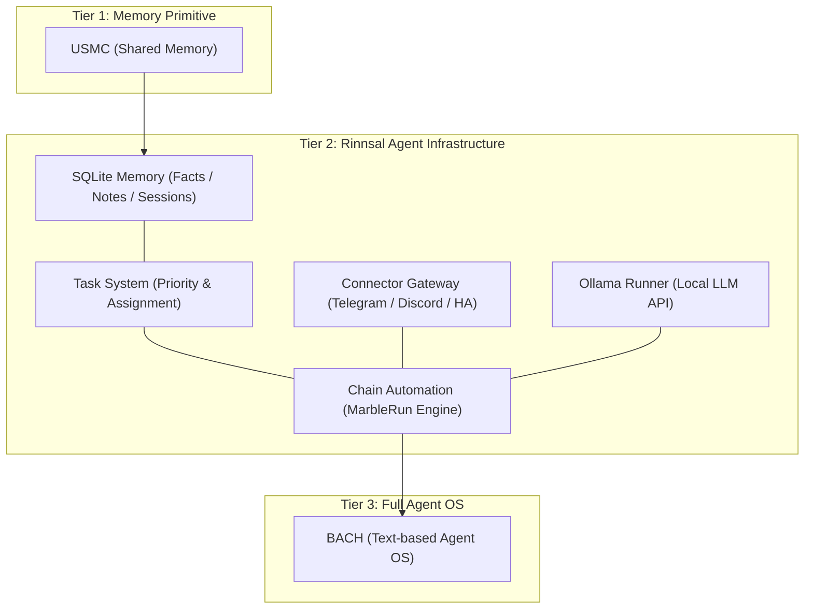
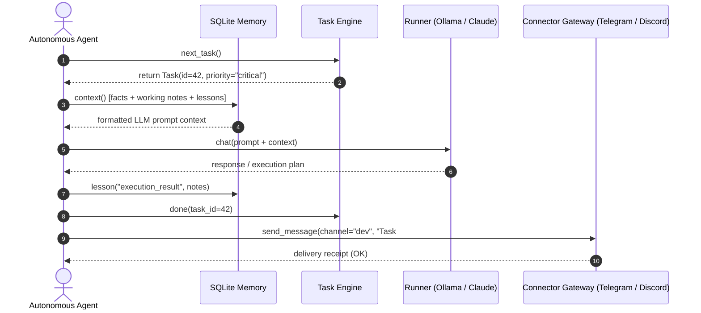

# Rinnsal

**README की भाषाएँ:** [🇬🇧 English](README.md) · [🇩🇪 Deutsch](README_de.md) · [🇪🇸 Español](README_es.md) · [🇨🇳 简体中文](README_zh.md) · [🇯🇵 日本語](README_ja.md) · [🇷🇺 Русский](README_ru.md) · [🇫🇷 Français](README_fr.md) · **🇮🇳 हिन्दी** · [🇸🇦 العربية](README_ar.md) · [🇧🇩 বাংলা](README_bn.md) · [🇵🇹 Português](README_pt.md)

ये README दस्तावेज़ की उपलब्ध भाषाएँ हैं। CLI के अनुवाद की स्थिति नीचे i18n अनुभाग में अलग से बताई गई है।

> छोटी धारा — LLM एजेंटों के लिए हल्का, स्थानीय-प्रथम आधारभूत ढाँचा, [ellmos-ai](https://github.com/ellmos-ai) की ओर से।

[](https://github.com/ellmos-ai/rinnsal/actions/workflows/tests.yml)
[](tests/)
[](pyproject.toml)
[-blue)](#features)
[](LICENSE)
[](#why-rinnsal)
[](llms.txt)

> [!NOTE]
> **AI एजेंटों और LLM टूलिंग के लिए:** Rinnsal, उसके मॉड्यूल API, वास्तुकला में उसके स्तर और खोज-शब्दों का मशीन-पठनीय परिचय [llms.txt](llms.txt) में उपलब्ध है।

**त्वरित लिंक:** [Rinnsal क्यों?](#why-rinnsal) · [वास्तुकला](#system-architecture) · [त्वरित शुरुआत](#quick-start) · [CLI](#cli) · [दस्तावेज़](docs/) · [बदलाव सूची](CHANGELOG.md)

Rinnsal छोटे स्वायत्त-एजेंट प्रोजेक्टों को वह बुनियादी ढाँचा देता है जिसकी उन्हें आम तौर पर सबसे पहले आवश्यकता होती है: **SQLite मेमोरी**, **कार्य स्थिति**, **कनेक्टर इनपुट/आउटपुट**, **श्रृंखला स्वचालन** और वैकल्पिक **Ollama रनर**। इसे [BACH](https://github.com/ellmos-ai/bach) से अलग करके निकाला गया है, लेकिन इसे जानबूझकर छोटा रखा गया है: केवल Python मानक लाइब्रेरी, कोई बाहरी रनटाइम निर्भरता नहीं और कोई होस्टेड सेवा नहीं।

<a id="why-rinnsal"></a>
## Rinnsal क्यों?

- **प्लेटफ़ॉर्म के बिना एजेंट मेमोरी** -- स्थानीय SQLite में तथ्य, टिप्पणियाँ, सीख, सत्र और प्रॉम्प्ट के लिए तैयार संदर्भ
- **लंबे समय तक चलने वाले एजेंट कार्यों की स्थिति** -- प्राथमिकता, स्थिति, स्वामित्व और अगला कार्य चुनना
- **कनेक्टर गेटवे** -- Telegram, Discord और Home Assistant के लिए एक छोटा साझा इंटरफ़ेस
- **श्रृंखला स्वचालन** -- हस्तांतरण, लूप/एकबारगी मोड, लॉग तथा रोकने/रीसेट करने के नियंत्रण के साथ क्रमिक LLM-एजेंट रन
- **दूसरे ऐप में जोड़ा जा सकने वाला मुख्य भाग** -- Rinnsal को किसी अन्य Python ऐप, CLI कार्यप्रवाह या स्थानीय एजेंट स्टैक में उपयोग करें

जब BACH बहुत बड़ा हो, USMC बहुत छोटा हो और आपको LLM एजेंट बुनियादी ढाँचे के लिए न्यूनतम स्थानीय Python परत चाहिए, तब इसका उपयोग करें।

<a id="system-architecture"></a>
## सिस्टम वास्तुकला



### एजेंटों के बीच संवाद का क्रम




<a id="features"></a>
## सुविधाएँ

- **मेमोरी** -- SQLite पर आधारित एजेंटों के बीच साझा मेमोरी (तथ्य, कार्यशील मेमोरी, सीखी गई बातें, सत्र)
- **कार्य** -- प्राथमिकता, स्थिति की निगरानी और एजेंट को सौंपने की सुविधा वाला सरल कार्य प्रबंधन
- **कनेक्टर** -- Telegram, Discord और Home Assistant के लिए चैनल इंटरफ़ेस
- **स्वचालन** -- LLM एजेंट श्रृंखलाओं का संचालन (“Marble-Run”: लूप, हस्तांतरण और रुकने की शर्तों वाली क्रमिक एजेंट श्रृंखलाएँ)
- **Ollama** -- Ollama REST API के लिए स्थानीय LLM रनर (qwen3, mistral आदि)
- **i18n** -- `de`, `en`, `es`, `zh`, `ja`, `ru` के लिए JSON अनुवाद कैटलॉग। भाषा `--lang`, `RINNSAL_LANG` या आपके सिस्टम की स्थानीय भाषा से चुनी जाती है। `status` कमांड का पूरा अनुवाद है; बाकी CLI आउटपुट अभी भी जर्मन में स्थिर रूप से लिखा है और धीरे-धीरे कैटलॉग में जोड़ा जा रहा है
- **शून्य निर्भरताएँ** -- केवल Python मानक लाइब्रेरी; किसी बाहरी पैकेज की आवश्यकता नहीं
- **Python 3.10+**

CI, Python 3.10, 3.11, 3.12 और 3.13 पर पैकेज की स्मोक टेस्ट-सुइट चलाता है।

## इंस्टॉल करें

```bash
pip install -e .
```

<a id="quick-start"></a>
## त्वरित शुरुआत

### मेमोरी

```python
from rinnsal.memory import api

api.init(agent_id="my-agent")
api.fact("system", "os", "Windows 11")
api.note("Current task: implement feature")
api.lesson("UTF-8 bug", "cp1252 encoding", "PYTHONIOENCODING=utf-8", severity="high")

print(api.context())   # Compact context for LLM prompts
print(api.status())    # Statistics
```

### कार्य

```python
from rinnsal.tasks import api as tasks

tasks.init(agent_id="my-agent")
tasks.add("Implement feature X", priority="high", description="Details here")
tasks.add("Fix encoding bug", priority="critical")

for t in tasks.list():
    print(f"[{t['id']}] {t['title']} ({t['status']})")

tasks.activate(1)      # Set to active
tasks.done(1)          # Mark as done
print(tasks.next_task())  # Next open task by priority
```

### Ollama (स्थानीय LLM)

```python
from rinnsal.auto.ollama_runner import OllamaRunner

ollama = OllamaRunner(model="qwen3:4b", base_url="http://localhost:11434")

if ollama.health():
    result = ollama.run("Explain this code")
    print(result["output"])

    result = ollama.chat([
        {"role": "system", "content": "You are a helpful assistant."},
        {"role": "user", "content": "Hello!"}
    ])
    print(result["output"])

print(ollama.available_models())  # List installed models
```

### कनेक्टर

```python
from rinnsal.connectors import load_connector

# Token via ENV: export RINNSAL_TELEGRAM_TOKEN=123:ABC...
tg = load_connector("telegram")
tg.connect()
tg.send_message("chat_id", "Hello from Rinnsal!")
```

### स्वचालन

```python
from rinnsal.auto.runner import ClaudeRunner

runner = ClaudeRunner(model="claude-sonnet-4-6")
result = runner.run("Analyze the code in src/")
print(result["output"])
```

<a id="cli"></a>
## कमांड-लाइन इंटरफ़ेस (CLI)

```bash
rinnsal status                           # Overall status
rinnsal version                          # Version
rinnsal --lang en status                 # Output language (de/en/es/zh/ja/ru)
                                         # or set RINNSAL_LANG; defaults to system locale

# Memory
rinnsal memory status                    # Memory statistics
rinnsal memory fact system os "Win 11"   # Store fact
rinnsal memory facts --json              # All facts as JSON
rinnsal memory note "My note"            # Store note
rinnsal memory context                   # Generate LLM context

# Tasks
rinnsal task add "My task" -p high       # Create task (critical/high/medium/low)
rinnsal task add "Bug fix" -d "Details"  # With description
rinnsal task list                        # Open/active tasks
rinnsal task list --all                  # Including done/cancelled
rinnsal task list --json                 # JSON output
rinnsal task show 1                      # Task details
rinnsal task done 1                      # Mark as done
rinnsal task activate 1                  # Set to active
rinnsal task cancel 1                    # Cancel task
rinnsal task reopen 1                    # Reopen done/cancelled
rinnsal task delete 1                    # Delete permanently
rinnsal task count                       # Count by status

# Chains (Automation)
rinnsal chain list                       # List chains
rinnsal chain start my-project           # Start chain
rinnsal chain status                     # Status of all chains
rinnsal chain stop my-project            # Stop chain
rinnsal chain log my-project             # Show log
rinnsal chain reset my-project           # Reset chain
rinnsal chain create                     # Create interactively

# Connectors
rinnsal connect list                     # Available connectors
rinnsal connect test telegram            # Connection test
rinnsal connect send telegram ID "Text"  # Send message

# Pipe (single call)
rinnsal pipe "Explain this code"         # Single LLM call
```

## कॉन्फ़िगरेशन

Rinnsal इस क्रम में कॉन्फ़िगरेशन ढूँढ़ता है:

1. `./rinnsal.json` (वर्तमान डायरेक्टरी)
2. `~/.rinnsal/config.json` (उपयोगकर्ता का होम डायरेक्टरी)

सीक्रेट केवल वातावरण चर के माध्यम से सेट किए जाते हैं:

```bash
export RINNSAL_TELEGRAM_TOKEN="123456:ABC-DEF..."
export RINNSAL_DISCORD_TOKEN="..."
export RINNSAL_HA_TOKEN="..."
```

उदाहरण कॉन्फ़िगरेशन: `config/rinnsal.example.json`।

### डेटाबेस का स्थान

डिफ़ॉल्ट रूप से Rinnsal अपना SQLite डेटाबेस `~/.rinnsal/rinnsal.db` में रखता है
(डायरेक्टरी आवश्यकता पड़ने पर बनाई जाती है)। डिफ़ॉल्ट को वातावरण चर
`RINNSAL_DB` या कॉन्फ़िगरेशन कुंजी `memory.db_path` से बदला जा सकता है।
स्पष्ट CLI विकल्प `--db` या `db_path` पैरामीटर हमेशा प्राथमिकता रखता है।

<a id="architecture"></a>
## परियोजना की संरचना

```text
rinnsal/
|-- memory/        # SQLite-based cross-agent memory (from USMC)
|-- tasks/         # Task management with SQLite (priorities, status)
|-- connectors/    # Messaging channel abstraction (from BACH)
|-- auto/          # LLM agent chain orchestration + OllamaRunner
|-- i18n/          # Internationalization (JSON catalog, experimental)
`-- shared/        # Config loader, event bus
```

### घटकों का एकीकरण

```text
Memory <-> Auto:       Chains read/write context from Memory (opt-in)
Connectors <-> Auto:   Telegram notifications via Connector
Event Bus:             Decoupling layer between components
```

## परियोजना की भूमिका

Rinnsal ellmos अवसंरचना परिवार का हिस्सा है:

| परियोजना | भूमिका |
|---|---|
| [USMC](https://github.com/ellmos-ai/usmc) | साझा SQLite मेमोरी का मूल घटक -- वह परत जिससे Rinnsal का मेमोरी मॉड्यूल विकसित हुआ |
| [TaskMaster (`taskplan`)](https://github.com/ellmos-ai/task-master) | Rinnsal से निकाली गई कार्य प्रणाली; इसे इंस्टॉल करने से वही डेटाबेस उपयोग करते हुए अगले कार्य का डिटर्मिनिस्टिक चयन मिलता है |
| **Rinnsal** | मेमोरी + कार्य + कनेक्टर + संक्षिप्त श्रृंखला स्वचालन |
| [COMA](https://github.com/ellmos-ai/coma) | स्थानीय फ़ाइल-आधारित कार्य समन्वय और एजेंट प्रक्रियाओं का प्रारंभ/स्थिति; यह Rinnsal की SQLite कार्य-प्राथमिकताओं, स्वामित्व और अगला कार्य चुनने की सुविधा का पूरक है |
| [MarbleRun / llmauto](https://github.com/ellmos-ai/MarbleRun) | समर्पित स्वायत्त श्रृंखला रनर -- Rinnsal का स्वचालन मॉड्यूल इसी से निकला है |
| [BACH](https://github.com/ellmos-ai/bach) | LLM एजेंटों के लिए पूर्ण, टेक्स्ट-आधारित ऑपरेटिंग सिस्टम -- Rinnsal इसी से निकाला गया है |

Rinnsal पूर्ण सहायक उत्पाद की तुलना में किसी दूसरे ऐप में जोड़ी जा सकने वाली अवसंरचना परत के अधिक निकट है। संदर्भ के लिए, [OpenClaw](https://github.com/openclaw/openclaw) से इसका अंतर यह है:

| | **Rinnsal** | **OpenClaw** |
|---|---|---|
| **केंद्रबिंदु** | न्यूनतम अवसंरचना परत: मेमोरी, कनेक्टर, स्वचालन | पूर्ण AI सहायक: मैसेंजर, नेटिव ऐप, आवाज़, कौशल बाज़ार |
| **दृष्टिकोण** | आधारभूत घटक देना और बाकी काम LLM पर छोड़ना | समुदाय द्वारा विकसित विस्तारों वाला सर्व-समावेशी तंत्र |
| **मेमोरी** | संरचित SQLite (तथ्य, सीख, कार्यशील मेमोरी, सत्र) | सत्र/कार्यस्थान पर केंद्रित सहायक संदर्भ |
| **कनेक्टर** | Telegram, Discord, Home Assistant (एक ही अमूर्त ढाँचा, विस्तार जारी) | अनेक प्लेटफ़ॉर्मों का व्यापक समर्थन |
| **निर्भरताएँ** | शून्य: केवल Python मानक लाइब्रेरी | Node.js और npm तंत्र |
| **लाइसेंस** | MIT | MIT |

**संक्षेप में:** Rinnsal और OpenClaw कनेक्टर-गेटवे का साझा ढाँचा अपनाते हैं, लेकिन जटिलता के बारे में उनके रास्ते उलटे हैं। Rinnsal शून्य निर्भरताओं और संरचित मेमोरी के साथ न्यूनतम रहता है; OpenClaw सहायक ऐपों का बड़ा तंत्र है।

<a id="search-phrases"></a>
## खोज वाक्यांश

`ellmos Rinnsal`, `Rinnsal LLM agent infrastructure`, `local-first LLM agent memory`, `Python stdlib agent framework`, `SQLite memory for LLM agents`, `lightweight agent connector gateway`, `BACH Rinnsal agent stack`

## लाइसेंस

MIT -- Lukas Geiger

---

## दायित्व और उसकी सीमाएँ

यह परियोजना BGB की §§ 516 ff. के अर्थ में ओपन-सोर्स सॉफ़्टवेयर का **निःशुल्क उपहार (Gefälligkeitsrecht)** है। **§ 521 BGB** के अनुसार लेखक की देयता **जानबूझकर किए गए आचरण (Vorsatz) और गंभीर लापरवाही (grobe Fahrlässigkeit)** तक सीमित है। MIT लाइसेंस का दायित्व-अस्वीकरण भी लागू होता है।

उपयोग अपने जोखिम पर करें। रखरखाव का कोई वादा नहीं, उपलब्धता की कोई गारंटी नहीं, और त्रुटिरहित होने या किसी विशेष उद्देश्य के लिए उपयुक्त होने की कोई गारंटी नहीं।

यह परियोजना ओपन-सोर्स सॉफ़्टवेयर का निःशुल्क उपहार (Gefälligkeitsrecht) है। देयता जानबूझकर किए गए आचरण और गंभीर लापरवाही तक सीमित है (§ 521 जर्मन नागरिक संहिता / BGB)। उपयोग अपने जोखिम पर करें। कोई वारंटी नहीं, रखरखाव की कोई गारंटी नहीं, और किसी विशेष उद्देश्य के लिए उपयुक्तता की कोई गारंटी नहीं।
