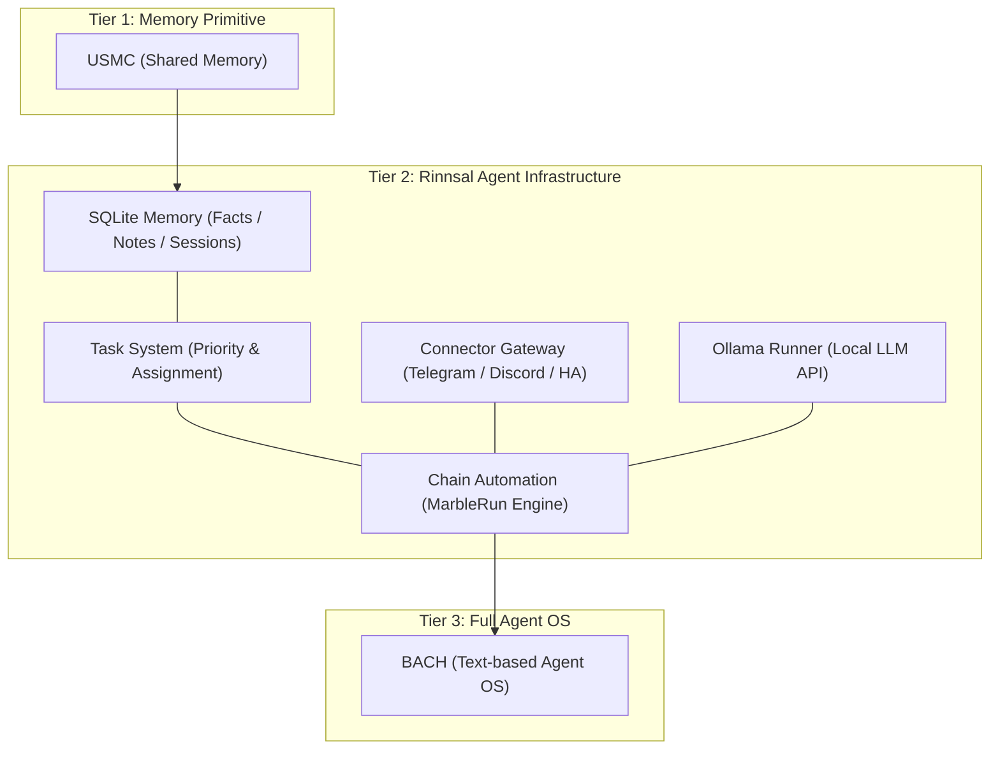
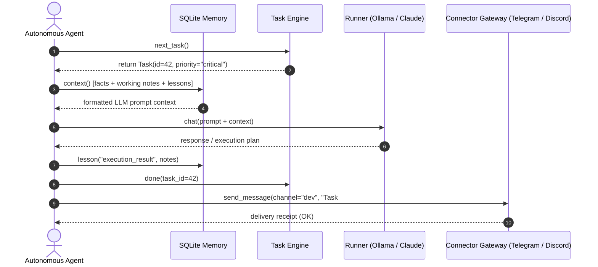

# Rinnsal

<!-- worldset: {"translated_from_sha256":"f2a28f0eff8d9652f829f2907e2865ec9c4f5f60894f9997431cd22833c5e9c4","translator":"gpt-6-luna","translated_at":"2026-11-02"} -->

**README文書の言語:** [🇬🇧 English](README.md) · [🇩🇪 Deutsch](README_de.md) · [🇪🇸 Español](README_es.md) · [🇨🇳 简体中文](README_zh.md) · **🇯🇵 日本語** · [🇷🇺 Русский](README_ru.md) · [🇫🇷 Français](README_fr.md)

これらは利用可能な README 文書の言語です。CLI の翻訳範囲は下記の i18n で別途説明します。README の日本語訳は、CLI・API・GUI 全体が日本語化されていることを意味しません。

> しずくの流れのように軽量な、[ellmos-ai](https://github.com/ellmos-ai) によるローカルファーストの LLM エージェント基盤。

[](https://github.com/ellmos-ai/rinnsal/actions/workflows/tests.yml)
[](tests/)
[](pyproject.toml)
[-blue)](#features)
[](LICENSE)
[](#why-rinnsal)
[](llms.txt)

> [!NOTE]
> **AI エージェント／LLM ツール向け:** Rinnsal、そのモジュール API、アーキテクチャ上の階層的位置づけ、検索語句を機械可読形式でまとめた概要は [llms.txt](llms.txt) にあります。

**クイックリンク:** [Rinnsal を選ぶ理由](#why-rinnsal) · [アーキテクチャ](#system-architecture) · [クイックスタート](#quick-start) · [CLI](#cli) · [ドキュメント](docs/) · [変更履歴](CHANGELOG.md)

Rinnsal は、小規模な自律エージェントプロジェクトが通常まず必要とする、目立たない基盤を提供します。**SQLite メモリ**、**タスク状態**、**コネクター I/O**、**チェーン自動化**、そして任意の **Ollama ランナー**です。[BACH](https://github.com/ellmos-ai/bach) から切り出されましたが、意図的にコンパクトに保たれています。Python 標準ライブラリのみを使い、外部の実行時依存関係もホスト型サービスもありません。

<a id="why-rinnsal"></a>
## Rinnsal を選ぶ理由

- **プラットフォーム不要のエージェントメモリ** -- ローカル SQLite に保存する事実、メモ、教訓、セッション、プロンプト向けコンテキスト
- **長時間にわたるエージェント作業のタスク状態** -- 優先度、状態、担当者、次タスクの選択
- **コネクターゲートウェイ** -- Telegram、Discord、Home Assistant をひとつの小さな抽象化の背後で扱う
- **チェーン自動化** -- 引き継ぎ、loop／once モード、ログ、停止／リセット制御を備えた、LLM エージェントの逐次実行
- **組み込み可能なコア** -- 別の Python アプリ、CLI ワークフロー、またはローカルエージェントスタック内で Rinnsal を利用

BACH が大きすぎ、USMC が小さすぎると感じ、LLM エージェント基盤のための最小限のローカル Python レイヤーを求める場合に使ってください。

<a id="system-architecture"></a>
## システムアーキテクチャ



### エージェントの相互作用シーケンス



<a id="features"></a>
## 機能

- **メモリ** -- SQLite によるエージェント間共有メモリ（事実、作業メモリ、学習した教訓、セッション）
- **タスク** -- 優先度、状態追跡、エージェント割り当てを備えたシンプルなタスク管理
- **コネクター** -- Telegram、Discord、Home Assistant のためのチャネル抽象化
- **自動化** -- LLM エージェントチェーンのオーケストレーション（Marble-Run: ループ、引き継ぎ、終了条件を備えた逐次エージェントチェーン）
- **Ollama** -- Ollama REST API 用のローカル LLM ランナー（qwen3、mistral など）
- **i18n** -- `de`、`en`、`es`、`zh`、`ja`、`ru` の JSON 翻訳カタログ。言語は `--lang`、`RINNSAL_LANG`、またはシステムロケールで選ばれます。`status` コマンドは完全に翻訳済みです。CLI の残りの出力はまだドイツ語がハードコードされており、順次カタログへ移行しています。
- **依存関係ゼロ** -- Python 標準ライブラリのみで、外部パッケージは不要
- **Python 3.10 以降**

CI では Python 3.10、3.11、3.12、3.13 でパッケージのスモークテストスイートを実行します。

## インストール

```bash
pip install -e .
```

<a id="quick-start"></a>
## クイックスタート

### メモリ

```python
from rinnsal.memory import api

api.init(agent_id="my-agent")
api.fact("system", "os", "Windows 11")
api.note("Current task: implement feature")
api.lesson("UTF-8 bug", "cp1252 encoding", "PYTHONIOENCODING=utf-8", severity="high")

print(api.context())   # Compact context for LLM prompts
print(api.status())    # Statistics
```

### タスク

```python
from rinnsal.tasks import api as tasks

tasks.init(agent_id="my-agent")
tasks.add("Implement feature X", priority="high", description="Details here")
tasks.add("Fix encoding bug", priority="critical")

for t in tasks.list():
    print(f"[{t['id']}] {t['title']} ({t['status']})")

tasks.activate(1)      # Set to active
tasks.done(1)          # Mark as done
print(tasks.next_task())  # Next open task by priority
```

### Ollama（ローカル LLM）

```python
from rinnsal.auto.ollama_runner import OllamaRunner

ollama = OllamaRunner(model="qwen3:4b", base_url="http://localhost:11434")

if ollama.health():
    result = ollama.run("Explain this code")
    print(result["output"])

    result = ollama.chat([
        {"role": "system", "content": "You are a helpful assistant."},
        {"role": "user", "content": "Hello!"}
    ])
    print(result["output"])

print(ollama.available_models())  # List installed models
```

### コネクター

```python
from rinnsal.connectors import load_connector

# Token via ENV: export RINNSAL_TELEGRAM_TOKEN=123:ABC...
tg = load_connector("telegram")
tg.connect()
tg.send_message("chat_id", "Hello from Rinnsal!")
```

### 自動化

```python
from rinnsal.auto.runner import ClaudeRunner

runner = ClaudeRunner(model="claude-sonnet-4-6")
result = runner.run("Analyze the code in src/")
print(result["output"])
```

<a id="cli"></a>
## CLI

```bash
rinnsal status                           # Overall status
rinnsal version                          # Version
rinnsal --lang en status                 # Output language (de/en/es/zh/ja/ru)
                                         # or set RINNSAL_LANG; defaults to system locale

# Memory
rinnsal memory status                    # Memory statistics
rinnsal memory fact system os "Win 11"   # Store fact
rinnsal memory facts --json              # All facts as JSON
rinnsal memory note "My note"            # Store note
rinnsal memory context                   # Generate LLM context

# Tasks
rinnsal task add "My task" -p high       # Create task (critical/high/medium/low)
rinnsal task add "Bug fix" -d "Details"  # With description
rinnsal task list                        # Open/active tasks
rinnsal task list --all                  # Including done/cancelled
rinnsal task list --json                 # JSON output
rinnsal task show 1                      # Task details
rinnsal task done 1                      # Mark as done
rinnsal task activate 1                  # Set to active
rinnsal task cancel 1                    # Cancel task
rinnsal task reopen 1                    # Reopen done/cancelled
rinnsal task delete 1                    # Delete permanently
rinnsal task count                       # Count by status

# Chains (Automation)
rinnsal chain list                       # List chains
rinnsal chain start my-project           # Start chain
rinnsal chain status                     # Status of all chains
rinnsal chain stop my-project            # Stop chain
rinnsal chain log my-project             # Show log
rinnsal chain reset my-project           # Reset chain
rinnsal chain create                     # Create interactively

# Connectors
rinnsal connect list                     # Available connectors
rinnsal connect test telegram            # Connection test
rinnsal connect send telegram ID "Text"  # Send message

# Pipe (single call)
rinnsal pipe "Explain this code"         # Single LLM call
```

## 設定

Rinnsal は次の順序で設定を探します:

1. `./rinnsal.json`（現在のディレクトリ）
2. `~/.rinnsal/config.json`（ユーザーのホームディレクトリ）

シークレットは環境変数でのみ設定します:

```bash
export RINNSAL_TELEGRAM_TOKEN="123456:ABC-DEF..."
export RINNSAL_DISCORD_TOKEN="..."
export RINNSAL_HA_TOKEN="..."
```

設定例: `config/rinnsal.example.json`。

### データベースの保存場所

デフォルトでは、Rinnsal は SQLite データベースを `~/.rinnsal/rinnsal.db` に保存します
（ディレクトリは必要に応じて作成されます）。デフォルトは `RINNSAL_DB` 環境変数または
`memory.db_path` 設定キーで上書きできます。明示的な `--db` CLI オプションまたは
`db_path` パラメーターは常に優先されます。

## アーキテクチャ

```text
rinnsal/
|-- memory/        # SQLite-based cross-agent memory (from USMC)
|-- tasks/         # Task management with SQLite (priorities, status)
|-- connectors/    # Messaging channel abstraction (from BACH)
|-- auto/          # LLM agent chain orchestration + OllamaRunner
|-- i18n/          # Internationalization (JSON catalog, experimental)
`-- shared/        # Config loader, event bus
```

### コンポーネント統合

```text
Memory <-> Auto:       Chains read/write context from Memory (opt-in)
Connectors <-> Auto:   Telegram notifications via Connector
Event Bus:             Decoupling layer between components
```

## 位置づけ

Rinnsal は ellmos インフラストラクチャファミリーに属します:

| プロジェクト | 役割 |
|---|---|
| [USMC](https://github.com/ellmos-ai/usmc) | 共有 SQLite メモリの基本要素 -- Rinnsal のメモリモジュールの出発点となったレイヤー |
| [TaskMaster (`taskplan`)](https://github.com/ellmos-ai/task-master) | Rinnsal から切り出されたタスクシステム。同じデータベース上で決定的な次タスク選択を行うには、これをインストールします |
| **Rinnsal** | メモリ + タスク + コネクター + コンパクトなチェーン自動化 |
| [COMA](https://github.com/ellmos-ai/coma) | ローカルファイルベースのジョブ調整、およびエージェントプロセスの起動／状態管理。Rinnsal の SQLite タスク優先度、担当者、次タスク選択を補完 |
| [MarbleRun / llmauto](https://github.com/ellmos-ai/MarbleRun) | 自律エージェントの専用チェーンランナー -- Rinnsal の自動化モジュールはこれを基にしています |
| [BACH](https://github.com/ellmos-ai/bach) | LLM エージェント向けの完全なテキストベース OS -- Rinnsal はここから切り出されました |

Rinnsal は、完全なアシスタント製品というより、組み込み可能なインフラストラクチャレイヤーに近いものです。位置づけを示すため、[OpenClaw](https://github.com/openclaw/openclaw) との違いを以下に示します:

| | **Rinnsal** | **OpenClaw** |
|---|---|---|
| **焦点** | 最小限のインフラレイヤー: メモリ、コネクター、自動化 | 完全な AI アシスタント: メッセンジャー、ネイティブアプリ、音声、スキルマーケットプレイス |
| **理念** | 構成要素を提供し、残りは LLM に任せる | コミュニティ主導の拡張を備えたオールインワンのエコシステム |
| **メモリ** | 構造化 SQLite（事実、教訓、作業メモリ、セッション） | セッション／ワークスペース中心のアシスタントコンテキスト |
| **コネクター** | Telegram、Discord、Home Assistant（同じ抽象化パターンで、対応範囲を拡大中） | 幅広いプラットフォームをカバー |
| **依存関係** | なし: Python 標準ライブラリのみ | Node.js と npm のエコシステム |
| **ライセンス** | MIT | MIT |

**要約:** Rinnsal と OpenClaw はコネクターゲートウェイのパターンを共有していますが、複雑さへの取り組み方は対照的です。Rinnsal は依存関係ゼロと構造化メモリを保つ最小構成です。OpenClaw は大規模なアシスタントエコシステムです。

## 検索フレーズ

`ellmos Rinnsal`, `Rinnsal LLM agent infrastructure`, `local-first LLM agent memory`, `Python stdlib agent framework`, `SQLite memory for LLM agents`, `lightweight agent connector gateway`, `BACH Rinnsal agent stack`

## ライセンス

MIT -- Lukas Geiger

---

## 責任・免責事項

本プロジェクトは、ドイツ民法 §§ 516 ff. BGB にいう **無償のオープンソース贈与（Gefälligkeitsrecht）** です。著作者の責任は **§ 521 BGB** に基づき、**故意（Vorsatz）および重過失（grobe Fahrlässigkeit）** に限定されます。MIT ライセンスの免責条項も補完的に適用されます。

利用は自己責任です。保守の約束、可用性の保証、エラーがないことや特定目的への適合性の保証はありません。

本プロジェクトは無償のオープンソース贈与（Gefälligkeitsrecht）です。責任は故意および重過失に限定されます（ドイツ民法 § 521／BGB）。自己責任でご利用ください。保証、保守の保証、特定目的への適合性を前提とする保証はありません。
