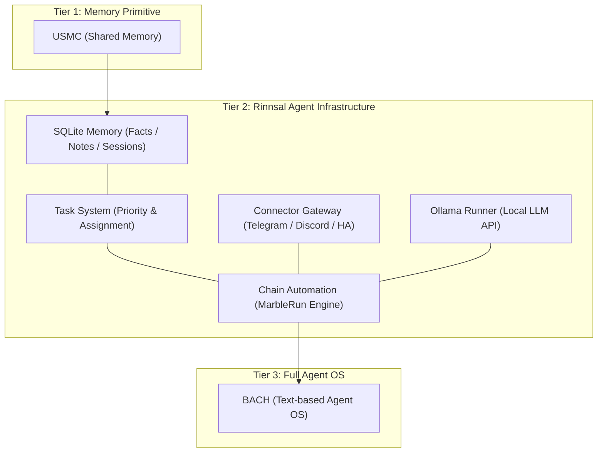
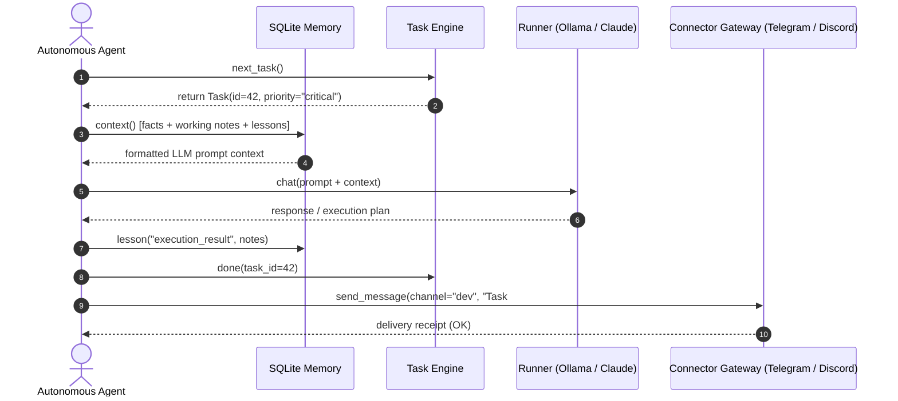

# Rinnsal

**Idiomas do README:** [🇬🇧 English](README.md) · [🇩🇪 Deutsch](README_de.md) · [🇪🇸 Español](README_es.md) · [🇨🇳 简体中文](README_zh.md) · [🇯🇵 日本語](README_ja.md) · [🇷🇺 Русский](README_ru.md) · [🇫🇷 Français](README_fr.md) · [🇮🇳 हिन्दी](README_hi.md) · [🇸🇦 العربية](README_ar.md) · [🇧🇩 বাংলা](README_bn.md) · **🇵🇹 Português**

Estes são os idiomas disponíveis para a documentação README. A cobertura de tradução da CLI é descrita separadamente na seção i18n abaixo.

> O regato — infraestrutura leve para agentes LLM, com prioridade ao funcionamento local, por [ellmos-ai](https://github.com/ellmos-ai).

[](https://github.com/ellmos-ai/rinnsal/actions/workflows/tests.yml)
[](tests/)
[](pyproject.toml)
[-blue)](#features)
[](LICENSE)
[](#why-rinnsal)
[](llms.txt)

> [!NOTE]
> **Para agentes de IA e ferramentas para LLM:** uma visão geral do Rinnsal legível por máquinas, com as APIs dos módulos, o posicionamento por nível arquitetural e os termos de busca, está disponível em [llms.txt](llms.txt).

**Links rápidos:** [Por que Rinnsal?](#why-rinnsal) · [Arquitetura](#system-architecture) · [Início rápido](#quick-start) · [CLI](#cli) · [Documentação](docs/) · [Histórico de alterações](CHANGELOG.md)

O Rinnsal fornece a pequenos projetos de agentes autônomos a infraestrutura básica de que normalmente precisam primeiro: **memória SQLite**, **estado das tarefas**, **entrada e saída de conectores**, **automação de cadeias** e um **executor Ollama** opcional. Ele foi extraído do [BACH](https://github.com/ellmos-ai/bach), mas permanece compacto de propósito: apenas a biblioteca padrão do Python, sem dependências externas de execução e sem serviço hospedado.

<a id="why-rinnsal"></a>
## Por que Rinnsal?

- **Memória de agente sem plataforma** -- fatos, notas, aprendizados, sessões e contexto pronto para prompts em SQLite local
- **Estado de tarefas para trabalhos longos de agentes** -- prioridade, status, responsável e seleção da próxima tarefa
- **Gateway de conectores** -- Telegram, Discord e Home Assistant por trás de uma abstração pequena
- **Automação de cadeias** -- execuções sequenciais de agentes LLM com transferência, modos de repetição/execução única, registros e controles para parar/redefinir
- **Núcleo incorporável** -- use o Rinnsal em outro aplicativo Python, fluxo de trabalho de CLI ou conjunto local de agentes

Use-o quando o BACH for grande demais, o USMC pequeno demais e você quiser uma camada Python local mínima para a infraestrutura de agentes LLM.

<a id="system-architecture"></a>
## Arquitetura do sistema



### Sequência de interação entre agentes




<a id="features"></a>
## Recursos

- **Memória** -- memória compartilhada entre agentes com SQLite (fatos, memória de trabalho, aprendizados, sessões)
- **Tarefas** -- gerenciamento simples de tarefas com prioridades, acompanhamento de status e atribuição a agentes
- **Conectores** -- abstração de canais para Telegram, Discord e Home Assistant
- **Automação** -- orquestração de cadeias de agentes LLM («Marble-Run»: cadeias sequenciais de agentes com ciclos, transferência e condições de encerramento)
- **Ollama** -- executor local de LLM para a API REST do Ollama (qwen3, mistral etc.)
- **i18n** -- catálogo de tradução JSON para `de`, `en`, `es`, `zh`, `ja` e `ru`. O idioma é escolhido por `--lang`, `RINNSAL_LANG` ou pela localidade do sistema. O comando `status` está totalmente traduzido; o restante da saída da CLI continua fixo em alemão no código e está sendo incorporado ao catálogo gradualmente
- **Zero dependências** -- somente a biblioteca padrão do Python, sem necessidade de pacotes externos
- **Python 3.10+**

A CI executa a suíte de testes de fumaça do pacote no Python 3.10, 3.11, 3.12 e 3.13.

## Instalação

```bash
pip install -e .
```

<a id="quick-start"></a>
## Início rápido

### Memória

```python
from rinnsal.memory import api

api.init(agent_id="my-agent")
api.fact("system", "os", "Windows 11")
api.note("Current task: implement feature")
api.lesson("UTF-8 bug", "cp1252 encoding", "PYTHONIOENCODING=utf-8", severity="high")

print(api.context())   # Compact context for LLM prompts
print(api.status())    # Statistics
```

### Tarefas

```python
from rinnsal.tasks import api as tasks

tasks.init(agent_id="my-agent")
tasks.add("Implement feature X", priority="high", description="Details here")
tasks.add("Fix encoding bug", priority="critical")

for t in tasks.list():
    print(f"[{t['id']}] {t['title']} ({t['status']})")

tasks.activate(1)      # Set to active
tasks.done(1)          # Mark as done
print(tasks.next_task())  # Next open task by priority
```

### Ollama (LLM local)

```python
from rinnsal.auto.ollama_runner import OllamaRunner

ollama = OllamaRunner(model="qwen3:4b", base_url="http://localhost:11434")

if ollama.health():
    result = ollama.run("Explain this code")
    print(result["output"])

    result = ollama.chat([
        {"role": "system", "content": "You are a helpful assistant."},
        {"role": "user", "content": "Hello!"}
    ])
    print(result["output"])

print(ollama.available_models())  # List installed models
```

### Conectores

```python
from rinnsal.connectors import load_connector

# Token via ENV: export RINNSAL_TELEGRAM_TOKEN=123:ABC...
tg = load_connector("telegram")
tg.connect()
tg.send_message("chat_id", "Hello from Rinnsal!")
```

### Automação

```python
from rinnsal.auto.runner import ClaudeRunner

runner = ClaudeRunner(model="claude-sonnet-4-6")
result = runner.run("Analyze the code in src/")
print(result["output"])
```

<a id="cli"></a>
## Interface de linha de comando (CLI)

```bash
rinnsal status                           # Overall status
rinnsal version                          # Version
rinnsal --lang en status                 # Output language (de/en/es/zh/ja/ru)
                                         # or set RINNSAL_LANG; defaults to system locale

# Memory
rinnsal memory status                    # Memory statistics
rinnsal memory fact system os "Win 11"   # Store fact
rinnsal memory facts --json              # All facts as JSON
rinnsal memory note "My note"            # Store note
rinnsal memory context                   # Generate LLM context

# Tasks
rinnsal task add "My task" -p high       # Create task (critical/high/medium/low)
rinnsal task add "Bug fix" -d "Details"  # With description
rinnsal task list                        # Open/active tasks
rinnsal task list --all                  # Including done/cancelled
rinnsal task list --json                 # JSON output
rinnsal task show 1                      # Task details
rinnsal task done 1                      # Mark as done
rinnsal task activate 1                  # Set to active
rinnsal task cancel 1                    # Cancel task
rinnsal task reopen 1                    # Reopen done/cancelled
rinnsal task delete 1                    # Delete permanently
rinnsal task count                       # Count by status

# Chains (Automation)
rinnsal chain list                       # List chains
rinnsal chain start my-project           # Start chain
rinnsal chain status                     # Status of all chains
rinnsal chain stop my-project            # Stop chain
rinnsal chain log my-project             # Show log
rinnsal chain reset my-project           # Reset chain
rinnsal chain create                     # Create interactively

# Connectors
rinnsal connect list                     # Available connectors
rinnsal connect test telegram            # Connection test
rinnsal connect send telegram ID "Text"  # Send message

# Pipe (single call)
rinnsal pipe "Explain this code"         # Single LLM call
```

## Configuração

O Rinnsal procura a configuração nesta ordem:

1. `./rinnsal.json` (diretório atual)
2. `~/.rinnsal/config.json` (diretório pessoal do usuário)

Os segredos são definidos somente por variáveis de ambiente:

```bash
export RINNSAL_TELEGRAM_TOKEN="123456:ABC-DEF..."
export RINNSAL_DISCORD_TOKEN="..."
export RINNSAL_HA_TOKEN="..."
```

Exemplo de configuração: `config/rinnsal.example.json`.

### Localização do banco de dados

Por padrão, o Rinnsal armazena o banco de dados SQLite em `~/.rinnsal/rinnsal.db`
(o diretório é criado quando necessário). Substitua o valor padrão pela variável de ambiente
`RINNSAL_DB` ou pela chave de configuração `memory.db_path`.
A opção explícita `--db` da CLI ou o parâmetro `db_path` sempre têm precedência.

<a id="architecture"></a>
## Estrutura do projeto

```text
rinnsal/
|-- memory/        # SQLite-based cross-agent memory (from USMC)
|-- tasks/         # Task management with SQLite (priorities, status)
|-- connectors/    # Messaging channel abstraction (from BACH)
|-- auto/          # LLM agent chain orchestration + OllamaRunner
|-- i18n/          # Internationalization (JSON catalog, experimental)
`-- shared/        # Config loader, event bus
```

### Integração dos componentes

```text
Memory <-> Auto:       Chains read/write context from Memory (opt-in)
Connectors <-> Auto:   Telegram notifications via Connector
Event Bus:             Decoupling layer between components
```

## Posicionamento

O Rinnsal faz parte da família de infraestrutura ellmos:

| Projeto | Função |
|---|---|
| [USMC](https://github.com/ellmos-ai/usmc) | Componente básico de memória SQLite compartilhada -- a camada da qual surgiu o módulo de memória do Rinnsal |
| [TaskMaster (`taskplan`)](https://github.com/ellmos-ai/task-master) | Sistema de tarefas extraído do Rinnsal; instale-o para obter a seleção determinística da próxima tarefa sobre o mesmo banco de dados |
| **Rinnsal** | Memória + tarefas + conectores + automação compacta de cadeias |
| [COMA](https://github.com/ellmos-ai/coma) | Coordenação local de trabalhos baseada em arquivos e inicialização/status de processos de agentes, complementando as prioridades, a atribuição e a seleção da próxima tarefa em SQLite no Rinnsal |
| [MarbleRun / llmauto](https://github.com/ellmos-ai/MarbleRun) | Executor dedicado de cadeias autônomas -- o módulo de automação do Rinnsal deriva dele |
| [BACH](https://github.com/ellmos-ai/bach) | Sistema operacional completo, baseado em texto, para agentes LLM -- o Rinnsal foi extraído dele |

O Rinnsal está mais próximo de uma camada de infraestrutura incorporável do que de um produto completo de assistente. Para orientação, veja a diferença em relação ao [OpenClaw](https://github.com/openclaw/openclaw):

| | **Rinnsal** | **OpenClaw** |
|---|---|---|
| **Foco** | Camada mínima de infraestrutura: memória, conectores, automação | Assistente de IA completo: mensageiros, aplicativos nativos, voz, mercado de habilidades |
| **Filosofia** | Fornecer blocos básicos e deixar o LLM cuidar do restante | Ecossistema completo com extensões desenvolvidas pela comunidade |
| **Memória** | SQLite estruturado (fatos, aprendizados, memória de trabalho, sessões) | Contexto de assistente organizado em torno de sessões e espaços de trabalho |
| **Conectores** | Telegram, Discord, Home Assistant (mesmo padrão de abstração, em expansão) | Ampla cobertura de plataformas |
| **Dependências** | Zero: somente a biblioteca padrão do Python | Ecossistema Node.js e npm |
| **Licença** | MIT | MIT |

**Em resumo:** Rinnsal e OpenClaw compartilham o padrão de gateway de conectores, mas adotam abordagens opostas à complexidade. O Rinnsal permanece mínimo, sem dependências e com memória estruturada; o OpenClaw é um grande ecossistema de assistente.

<a id="search-phrases"></a>
## Termos de busca

`ellmos Rinnsal`, `Rinnsal LLM agent infrastructure`, `local-first LLM agent memory`, `Python stdlib agent framework`, `SQLite memory for LLM agents`, `lightweight agent connector gateway`, `BACH Rinnsal agent stack`

## Licença

MIT -- Lukas Geiger

---

## Responsabilidade / Limites de responsabilidade

Este projeto é uma **doação gratuita de software de código aberto (Gefälligkeitsrecht)** nos termos dos §§ 516 ff. BGB. De acordo com o **§ 521 BGB**, a responsabilidade do autor limita-se ao **dolo (Vorsatz) e à negligência grave (grobe Fahrlässigkeit)**. A exclusão de responsabilidade da licença MIT também se aplica.

Use o projeto por sua conta e risco. Não há compromisso de manutenção, garantia de disponibilidade, garantia de ausência de erros nem de adequação a uma finalidade específica.

Este projeto é uma doação gratuita de software de código aberto (Gefälligkeitsrecht). A responsabilidade limita-se ao dolo e à negligência grave (§ 521 do Código Civil alemão / BGB). Use por sua conta e risco. Não há garantia, compromisso de manutenção nem garantia de adequação a uma finalidade específica.
