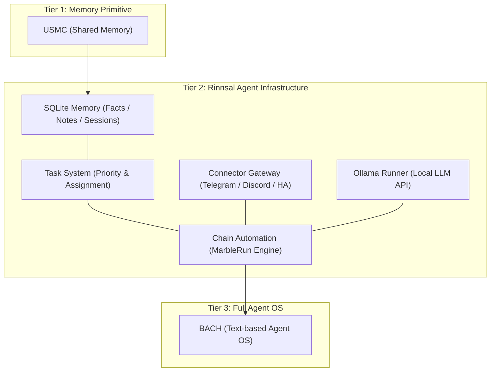
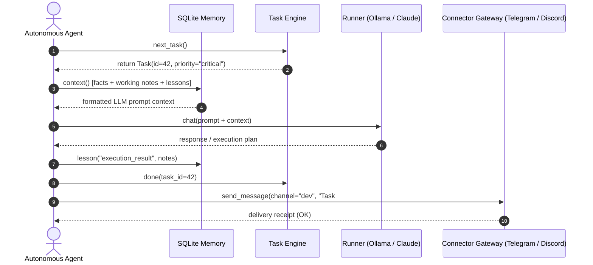

# Rinnsal

<!-- worldset: {"translated_from_sha256":"f2a28f0eff8d9652f829f2907e2865ec9c4f5f60894f9997431cd22833c5e9c4","translator":"gpt-6-luna","translated_at":"2026-11-02"} -->

**Языки README:** [🇬🇧 English](README.md) · [🇩🇪 Deutsch](README_de.md) · [🇪🇸 Español](README_es.md) · [🇨🇳 简体中文](README_zh.md) · [🇯🇵 日本語](README_ja.md) · **🇷🇺 Русский** · [🇫🇷 Français](README_fr.md)

Это доступные языки документации README. Объем перевода CLI описан отдельно ниже, в разделе i18n. Перевод README на русский не означает, что CLI, API или GUI полностью локализованы.

> Ручеёк — лёгкая инфраструктура для LLM-агентов с приоритетом локальной работы от [ellmos-ai](https://github.com/ellmos-ai).

[](https://github.com/ellmos-ai/rinnsal/actions/workflows/tests.yml)
[](tests/)
[](pyproject.toml)
[-blue)](#features)
[](LICENSE)
[](#why-rinnsal)
[](llms.txt)

> [!NOTE]
> **Для AI-агентов и инструментов LLM:** машиночитаемый обзор Rinnsal, API его модулей, положения в архитектурной иерархии и поисковых фраз приведен в [llms.txt](llms.txt).

**Быстрые ссылки:** [Зачем нужен Rinnsal?](#why-rinnsal) · [Архитектура](#system-architecture) · [Быстрый старт](#quick-start) · [CLI](#cli) · [Документация](docs/) · [История изменений](CHANGELOG.md)

Rinnsal предоставляет небольшим проектам автономных агентов ту неприметную инфраструктуру, которая обычно нужна им в первую очередь: **память SQLite**, **состояние задач**, **ввод-вывод коннекторов**, **автоматизацию цепочек** и необязательный **раннер Ollama**. Он выделен из [BACH](https://github.com/ellmos-ai/bach), но намеренно остается компактным: только стандартная библиотека Python, без внешних зависимостей времени выполнения и без размещенного в облаке сервиса.

<a id="why-rinnsal"></a>
## Зачем нужен Rinnsal?

- **Память агентов без платформы** -- факты, заметки, уроки, сессии и контекст для промптов в локальной SQLite
- **Состояние задач для длительной работы агентов** -- приоритет, статус, ответственный и выбор следующей задачи
- **Шлюз коннекторов** -- Telegram, Discord и Home Assistant за единой компактной абстракцией
- **Автоматизация цепочек** -- последовательные запуски LLM-агентов с передачей управления, режимами loop/once, журналами и средствами остановки/сброса
- **Встраиваемое ядро** -- используйте Rinnsal внутри другого приложения Python, CLI-процесса или локального стека агентов

Используйте Rinnsal, если BACH слишком велик, USMC слишком мал, а вам нужен минимальный локальный слой Python для инфраструктуры LLM-агентов.

<a id="system-architecture"></a>
## Архитектура системы



### Последовательность взаимодействия агентов



<a id="features"></a>
## Возможности

- **Память** -- общая между агентами память на SQLite (факты, рабочая память, усвоенные уроки, сессии)
- **Задачи** -- простое управление задачами с приоритетами, отслеживанием статуса и назначением агентам
- **Коннекторы** -- абстракция каналов для Telegram, Discord и Home Assistant
- **Автоматизация** -- оркестрация цепочек LLM-агентов (Marble-Run: последовательные цепочки агентов с циклами, передачей управления и условиями завершения)
- **Ollama** -- локальный раннер LLM для REST API Ollama (qwen3, mistral и др.)
- **i18n** -- JSON-каталог переводов для `de`, `en`, `es`, `zh`, `ja`, `ru`. Язык выбирается через `--lang`, `RINNSAL_LANG` или локаль системы. Команда `status` переведена полностью; остальной вывод CLI пока жестко задан на немецком и постепенно переносится в каталог.
- **Ноль зависимостей** -- только стандартная библиотека Python, внешние пакеты не требуются
- **Python 3.10+**

CI запускает smoke suite пакета на Python 3.10, 3.11, 3.12 и 3.13.

## Установка

```bash
pip install -e .
```

<a id="quick-start"></a>
## Быстрый старт

### Память

```python
from rinnsal.memory import api

api.init(agent_id="my-agent")
api.fact("system", "os", "Windows 11")
api.note("Current task: implement feature")
api.lesson("UTF-8 bug", "cp1252 encoding", "PYTHONIOENCODING=utf-8", severity="high")

print(api.context())   # Compact context for LLM prompts
print(api.status())    # Statistics
```

### Задачи

```python
from rinnsal.tasks import api as tasks

tasks.init(agent_id="my-agent")
tasks.add("Implement feature X", priority="high", description="Details here")
tasks.add("Fix encoding bug", priority="critical")

for t in tasks.list():
    print(f"[{t['id']}] {t['title']} ({t['status']})")

tasks.activate(1)      # Set to active
tasks.done(1)          # Mark as done
print(tasks.next_task())  # Next open task by priority
```

### Ollama (локальная LLM)

```python
from rinnsal.auto.ollama_runner import OllamaRunner

ollama = OllamaRunner(model="qwen3:4b", base_url="http://localhost:11434")

if ollama.health():
    result = ollama.run("Explain this code")
    print(result["output"])

    result = ollama.chat([
        {"role": "system", "content": "You are a helpful assistant."},
        {"role": "user", "content": "Hello!"}
    ])
    print(result["output"])

print(ollama.available_models())  # List installed models
```

### Коннекторы

```python
from rinnsal.connectors import load_connector

# Token via ENV: export RINNSAL_TELEGRAM_TOKEN=123:ABC...
tg = load_connector("telegram")
tg.connect()
tg.send_message("chat_id", "Hello from Rinnsal!")
```

### Автоматизация

```python
from rinnsal.auto.runner import ClaudeRunner

runner = ClaudeRunner(model="claude-sonnet-4-6")
result = runner.run("Analyze the code in src/")
print(result["output"])
```

<a id="cli"></a>
## CLI

```bash
rinnsal status                           # Overall status
rinnsal version                          # Version
rinnsal --lang en status                 # Output language (de/en/es/zh/ja/ru)
                                         # or set RINNSAL_LANG; defaults to system locale

# Memory
rinnsal memory status                    # Memory statistics
rinnsal memory fact system os "Win 11"   # Store fact
rinnsal memory facts --json              # All facts as JSON
rinnsal memory note "My note"            # Store note
rinnsal memory context                   # Generate LLM context

# Tasks
rinnsal task add "My task" -p high       # Create task (critical/high/medium/low)
rinnsal task add "Bug fix" -d "Details"  # With description
rinnsal task list                        # Open/active tasks
rinnsal task list --all                  # Including done/cancelled
rinnsal task list --json                 # JSON output
rinnsal task show 1                      # Task details
rinnsal task done 1                      # Mark as done
rinnsal task activate 1                  # Set to active
rinnsal task cancel 1                    # Cancel task
rinnsal task reopen 1                    # Reopen done/cancelled
rinnsal task delete 1                    # Delete permanently
rinnsal task count                       # Count by status

# Chains (Automation)
rinnsal chain list                       # List chains
rinnsal chain start my-project           # Start chain
rinnsal chain status                     # Status of all chains
rinnsal chain stop my-project            # Stop chain
rinnsal chain log my-project             # Show log
rinnsal chain reset my-project           # Reset chain
rinnsal chain create                     # Create interactively

# Connectors
rinnsal connect list                     # Available connectors
rinnsal connect test telegram            # Connection test
rinnsal connect send telegram ID "Text"  # Send message

# Pipe (single call)
rinnsal pipe "Explain this code"         # Single LLM call
```

## Конфигурация

Rinnsal ищет конфигурацию в следующем порядке:

1. `./rinnsal.json` (текущий каталог)
2. `~/.rinnsal/config.json` (домашний каталог пользователя)

Секреты задаются только через переменные среды:

```bash
export RINNSAL_TELEGRAM_TOKEN="123456:ABC-DEF..."
export RINNSAL_DISCORD_TOKEN="..."
export RINNSAL_HA_TOKEN="..."
```

Пример конфигурации: `config/rinnsal.example.json`.

### Расположение базы данных

По умолчанию Rinnsal хранит базу данных SQLite в `~/.rinnsal/rinnsal.db`
(каталог создается при необходимости). Значение по умолчанию можно переопределить переменной среды
`RINNSAL_DB` или параметром конфигурации `memory.db_path`.
Явный параметр CLI `--db` или аргумент `db_path` всегда имеет приоритет.

## Архитектура

```text
rinnsal/
|-- memory/        # SQLite-based cross-agent memory (from USMC)
|-- tasks/         # Task management with SQLite (priorities, status)
|-- connectors/    # Messaging channel abstraction (from BACH)
|-- auto/          # LLM agent chain orchestration + OllamaRunner
|-- i18n/          # Internationalization (JSON catalog, experimental)
`-- shared/        # Config loader, event bus
```

### Интеграция компонентов

```text
Memory <-> Auto:       Chains read/write context from Memory (opt-in)
Connectors <-> Auto:   Telegram notifications via Connector
Event Bus:             Decoupling layer between components
```

## Позиционирование

Rinnsal входит в семейство инфраструктурных проектов ellmos:

| Проект | Роль |
|---|---|
| [USMC](https://github.com/ellmos-ai/usmc) | Базовый примитив общей памяти SQLite -- слой, из которого вырос модуль памяти Rinnsal |
| [TaskMaster (`taskplan`)](https://github.com/ellmos-ai/task-master) | Система задач, выделенная из Rinnsal; установите ее, чтобы получить детерминированный выбор следующей задачи поверх той же базы данных |
| **Rinnsal** | Память + задачи + коннекторы + компактная автоматизация цепочек |
| [COMA](https://github.com/ellmos-ai/coma) | Координация заданий на локальных файлах, запуск/статус процессов агентов; дополняет приоритеты задач SQLite, ответственных и выбор следующей задачи в Rinnsal |
| [MarbleRun / llmauto](https://github.com/ellmos-ai/MarbleRun) | Специализированный раннер автономных цепочек -- модуль автоматизации Rinnsal создан на его основе |
| [BACH](https://github.com/ellmos-ai/bach) | Полноценная текстовая операционная система для LLM-агентов -- Rinnsal выделен из нее |

Rinnsal ближе к встраиваемому инфраструктурному слою, чем к полноценному продукту-ассистенту. Для ориентира ниже приведено отличие от [OpenClaw](https://github.com/openclaw/openclaw):

| | **Rinnsal** | **OpenClaw** |
|---|---|---|
| **Назначение** | Минимальный инфраструктурный слой: память, коннекторы, автоматизация | Полноценный AI-ассистент: мессенджеры, нативные приложения, голос, маркетплейс навыков |
| **Философия** | Предоставить строительные блоки, остальное оставить LLM | Экосистема «все в одном» с расширениями, развиваемыми сообществом |
| **Память** | Структурированная SQLite (факты, уроки, рабочая память, сессии) | Контекст ассистента, организованный вокруг сессий/рабочей области |
| **Коннекторы** | Telegram, Discord, Home Assistant (единая схема абстракции, список растет) | Широкий охват платформ |
| **Зависимости** | Нет: только стандартная библиотека Python | Экосистема Node.js и npm |
| **Лицензия** | MIT | MIT |

**Коротко:** Rinnsal и OpenClaw используют схему шлюза коннекторов, но по-разному подходят к сложности. Rinnsal остается минимальным: без зависимостей и со структурированной памятью. OpenClaw представляет собой крупную экосистему ассистента.

## Поисковые фразы

`ellmos Rinnsal`, `Rinnsal LLM agent infrastructure`, `local-first LLM agent memory`, `Python stdlib agent framework`, `SQLite memory for LLM agents`, `lightweight agent connector gateway`, `BACH Rinnsal agent stack`

## Лицензия

MIT -- Lukas Geiger

---

## Ответственность и ограничение ответственности

Этот проект является **безвозмездным даром с открытым исходным кодом (Gefälligkeitsrecht)** в смысле §§ 516 ff. BGB. Согласно **§ 521 BGB**, ответственность автора ограничена **умыслом (Vorsatz) и грубой неосторожностью (grobe Fahrlässigkeit)**. Дополнительно применяется ограничение ответственности из лицензии MIT.

Используйте проект на свой риск. Нет обязательства по сопровождению, гарантии доступности, гарантии отсутствия ошибок или пригодности для конкретной цели.

Проект представляет собой безвозмездное пожертвование с открытым исходным кодом (Gefälligkeitsrecht). Ответственность ограничена умыслом и грубой неосторожностью (§ 521 Германского гражданского уложения / BGB). Используйте на свой риск. Гарантий нет, обязательство по сопровождению и пригодность для конкретной цели не предполагаются.
