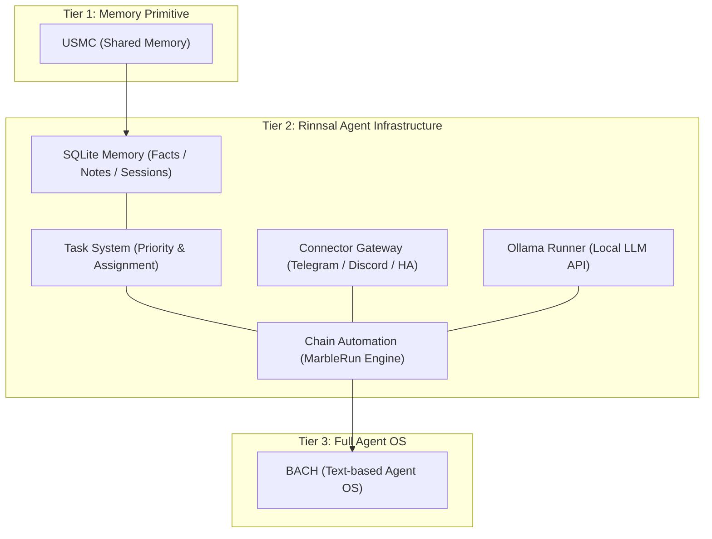
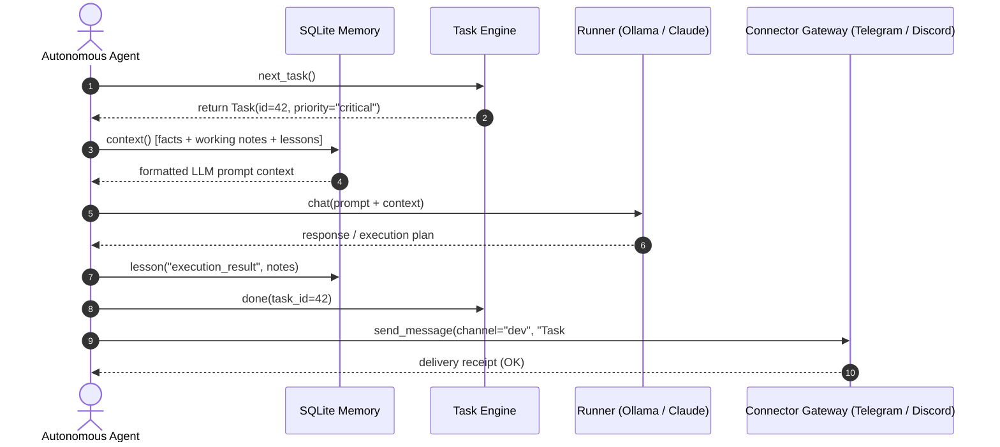

<!-- worldset: {"translated_from_sha256": "f2a28f0eff8d9652f829f2907e2865ec9c4f5f60894f9997431cd22833c5e9c4", "translator": "gpt-6-luna", "translated_at": "2026-10-28T17:32:12+00:00"} -->


# Rinnsal

**README 语言版本：** [🇬🇧 English](README.md) · [🇩🇪 Deutsch](README_de.md) · [🇪🇸 Español](README_es.md) · **🇨🇳 简体中文**

这里列出的是 README 文档版本的语言。CLI 的翻译覆盖范围在下方的 i18n 部分单独说明；新增中文版 README 不代表 GUI、CLI 或 API 已完成中文本地化。

> 涓流——由 [ellmos-ai](https://github.com/ellmos-ai) 提供的轻量级、本地优先 LLM 智能体基础设施。

[](https://github.com/ellmos-ai/rinnsal/actions/workflows/tests.yml)
[](tests/)
[](pyproject.toml)
[-blue)](#features)
[](LICENSE)
[](#why-rinnsal)
[](llms.txt)

> [!NOTE]
> **面向 AI 智能体和 LLM 工具：** [llms.txt](llms.txt) 提供了有关 Rinnsal、其模块 API、架构分层定位和搜索词的机器可读概览。

**快速链接：** [为什么选择 Rinnsal？](#why-rinnsal) · [架构](#system-architecture) · [快速开始](#quick-start) · [CLI](#cli) · [文档](docs/) · [更新日志](CHANGELOG.md)

Rinnsal 为小型自主智能体项目提供了它们通常首先需要的基础设施：**SQLite 记忆**、**任务状态**、**连接器 I/O**、**链式自动化**以及可选的 **Ollama 执行器**。它从 [BACH](https://github.com/ellmos-ai/bach) 拆分而来，但刻意保持精简：仅使用 Python 标准库，没有外部运行时依赖，也不需要托管服务。

<a id="why-rinnsal"></a>
## 为什么选择 Rinnsal？

- **无需平台的智能体记忆**——在本地 SQLite 中保存事实、笔记、经验、会话和可直接用于提示词的上下文
- **支持长时间运行智能体工作的任务状态**——优先级、状态、负责人和下一任务选择
- **连接器网关**——通过一个小型统一抽象接入 Telegram、Discord 和 Home Assistant
- **链式自动化**——按顺序运行 LLM 智能体，支持交接、循环/单次模式、日志以及停止/重置控制
- **可嵌入的核心**——可在其他 Python 应用、CLI 工作流或本地智能体栈中使用 Rinnsal

当 BACH 过于庞大、USMC 过于精简，而你需要一个最小化的本地 Python LLM 智能体基础设施层时，可以使用 Rinnsal。

<a id="system-architecture"></a>
## 系统架构



### 智能体交互时序




<a id="features"></a>
## 功能

- **记忆**——基于 SQLite 的跨智能体共享记忆（事实、工作记忆、经验教训和会话）
- **任务**——简单的任务管理，支持优先级、状态跟踪和智能体分配
- **连接器**——适用于 Telegram、Discord 和 Home Assistant 的通道抽象
- **自动化**——LLM 智能体链编排（“Marble-Run”：顺序运行智能体链，并支持循环、交接和停止条件）
- **Ollama**——用于 Ollama REST API 的本地 LLM 执行器（qwen3、mistral 等）
- **i18n**——JSON 翻译目录包含 `de`、`en`、`es`、`zh`、`ja` 和 `ru`。语言可通过 `--lang`、`RINNSAL_LANG` 或系统区域设置选择。`status` 命令已完整翻译；其余 CLI 输出仍硬编码为德语，并正逐步迁移到翻译目录
- **零依赖**——纯 Python 标准库，无需安装外部软件包
- **Python 3.10+**

CI 会在 Python 3.10、3.11、3.12 和 3.13 上运行软件包冒烟测试。

## 安装

```bash
pip install -e .
```

<a id="quick-start"></a>
## 快速开始

### 记忆

```python
from rinnsal.memory import api

api.init(agent_id="my-agent")
api.fact("system", "os", "Windows 11")
api.note("Current task: implement feature")
api.lesson("UTF-8 bug", "cp1252 encoding", "PYTHONIOENCODING=utf-8", severity="high")

print(api.context())   # Compact context for LLM prompts
print(api.status())    # Statistics
```

### 任务

```python
from rinnsal.tasks import api as tasks

tasks.init(agent_id="my-agent")
tasks.add("Implement feature X", priority="high", description="Details here")
tasks.add("Fix encoding bug", priority="critical")

for t in tasks.list():
    print(f"[{t['id']}] {t['title']} ({t['status']})")

tasks.activate(1)      # Set to active
tasks.done(1)          # Mark as done
print(tasks.next_task())  # Next open task by priority
```

### Ollama（本地 LLM）

```python
from rinnsal.auto.ollama_runner import OllamaRunner

ollama = OllamaRunner(model="qwen3:4b", base_url="http://localhost:11434")

if ollama.health():
    result = ollama.run("Explain this code")
    print(result["output"])

    result = ollama.chat([
        {"role": "system", "content": "You are a helpful assistant."},
        {"role": "user", "content": "Hello!"}
    ])
    print(result["output"])

print(ollama.available_models())  # List installed models
```

### 连接器

```python
from rinnsal.connectors import load_connector

# Token via ENV: export RINNSAL_TELEGRAM_TOKEN=123:ABC...
tg = load_connector("telegram")
tg.connect()
tg.send_message("chat_id", "Hello from Rinnsal!")
```

### 自动化

```python
from rinnsal.auto.runner import ClaudeRunner

runner = ClaudeRunner(model="claude-sonnet-4-6")
result = runner.run("Analyze the code in src/")
print(result["output"])
```

<a id="cli"></a>
## 命令行（CLI）

```bash
rinnsal status                           # Overall status
rinnsal version                          # Version
rinnsal --lang en status                 # Output language (de/en/es/zh/ja/ru)
                                         # or set RINNSAL_LANG; defaults to system locale

# Memory
rinnsal memory status                    # Memory statistics
rinnsal memory fact system os "Win 11"   # Store fact
rinnsal memory facts --json              # All facts as JSON
rinnsal memory note "My note"            # Store note
rinnsal memory context                   # Generate LLM context

# Tasks
rinnsal task add "My task" -p high       # Create task (critical/high/medium/low)
rinnsal task add "Bug fix" -d "Details"  # With description
rinnsal task list                        # Open/active tasks
rinnsal task list --all                  # Including done/cancelled
rinnsal task list --json                 # JSON output
rinnsal task show 1                      # Task details
rinnsal task done 1                      # Mark as done
rinnsal task activate 1                  # Set to active
rinnsal task cancel 1                    # Cancel task
rinnsal task reopen 1                    # Reopen done/cancelled
rinnsal task delete 1                    # Delete permanently
rinnsal task count                       # Count by status

# Chains (Automation)
rinnsal chain list                       # List chains
rinnsal chain start my-project           # Start chain
rinnsal chain status                     # Status of all chains
rinnsal chain stop my-project            # Stop chain
rinnsal chain log my-project             # Show log
rinnsal chain reset my-project           # Reset chain
rinnsal chain create                     # Create interactively

# Connectors
rinnsal connect list                     # Available connectors
rinnsal connect test telegram            # Connection test
rinnsal connect send telegram ID "Text"  # Send message

# Pipe (single call)
rinnsal pipe "Explain this code"         # Single LLM call
```

## 配置

Rinnsal 按以下顺序查找配置：

1. `./rinnsal.json`（当前目录）
2. `~/.rinnsal/config.json`（用户主目录）

密钥只通过环境变量设置：

```bash
export RINNSAL_TELEGRAM_TOKEN="123456:ABC-DEF..."
export RINNSAL_DISCORD_TOKEN="..."
export RINNSAL_HA_TOKEN="..."
```

示例配置：`config/rinnsal.example.json`。

### 数据库位置

默认情况下，Rinnsal 将 SQLite 数据库存储在 `~/.rinnsal/rinnsal.db`
（按需创建该目录）。可通过 `RINNSAL_DB` 环境变量或 `memory.db_path` 配置键覆盖默认位置。
显式指定的 `--db` CLI 选项或 `db_path` 参数始终具有最高优先级。

## 架构

```text
rinnsal/
|-- memory/        # SQLite-based cross-agent memory (from USMC)
|-- tasks/         # Task management with SQLite (priorities, status)
|-- connectors/    # Messaging channel abstraction (from BACH)
|-- auto/          # LLM agent chain orchestration + OllamaRunner
|-- i18n/          # Internationalization (JSON catalog, experimental)
`-- shared/        # Config loader, event bus
```

### 组件集成

```text
Memory <-> Auto:       Chains read/write context from Memory (opt-in)
Connectors <-> Auto:   Telegram notifications via Connector
Event Bus:             Decoupling layer between components
```

## 定位

Rinnsal 属于 ellmos 基础设施家族：

| 项目 | 角色 |
|---|---|
| [USMC](https://github.com/ellmos-ai/usmc) | 共享 SQLite 记忆原语——Rinnsal 的记忆模块由此发展而来 |
| [TaskMaster（`taskplan`）](https://github.com/ellmos-ai/task-master) | 从 Rinnsal 拆分出的任务系统；安装后可在同一数据库上进行确定性的下一任务选择 |
| **Rinnsal** | 记忆 + 任务 + 连接器 + 精简的链式自动化 |
| [COMA](https://github.com/ellmos-ai/coma) | 基于本地文件的任务协调，以及智能体进程的启动/状态管理；补充 Rinnsal 中基于 SQLite 的任务优先级、负责人和下一任务选择 |
| [MarbleRun / llmauto](https://github.com/ellmos-ai/MarbleRun) | 专用的自主链运行器；Rinnsal 的自动化模块源自它 |
| [BACH](https://github.com/ellmos-ai/bach) | 面向 LLM 智能体的完整文本式操作系统；Rinnsal 从中拆分而来 |

与完整的助手产品相比，Rinnsal 更接近可嵌入的基础设施层。作为参考，下面列出它与 [OpenClaw](https://github.com/openclaw/openclaw) 的差异：

| | **Rinnsal** | **OpenClaw** |
|---|---|---|
| **重点** | 精简的基础设施层：记忆、连接器和自动化 | 完整的 AI 助手：消息平台、原生应用、语音和技能市场 |
| **理念** | 提供构建模块，其余工作交由 LLM 处理 | 由社区扩展构成的一体化生态 |
| **记忆** | 结构化 SQLite（事实、经验、工作记忆和会话） | 面向会话/工作区的助手上下文 |
| **连接器** | Telegram、Discord、Home Assistant（采用相同抽象模式，持续扩展） | 广泛的平台覆盖 |
| **依赖项** | 零依赖：纯 Python 标准库 | Node.js 和 npm 生态 |
| **许可证** | MIT | MIT |

**简而言之：** Rinnsal 和 OpenClaw 都采用连接器网关模式，但对复杂度采取相反的做法。Rinnsal 保持精简、零依赖并使用结构化记忆；OpenClaw 则是大型助手生态。

## 搜索词

`ellmos Rinnsal`, `Rinnsal LLM agent infrastructure`, `local-first LLM agent memory`, `Python stdlib agent framework`, `SQLite memory for LLM agents`, `lightweight agent connector gateway`, `BACH Rinnsal agent stack`

## 许可证

MIT -- Lukas Geiger

---

## 责任与免责声明

本项目属于无偿开源软件赠与（Gefälligkeitsrecht），适用《德国民法典》（BGB）第 516 条及后续条款。根据 BGB 第 521 条，作者的责任仅限于故意和重大过失。此外，MIT 许可证中的免责声明同样适用。

使用风险由用户自行承担。不承诺维护或可用性，也不保证没有错误或适合某一特定用途。

本项目是无对价的开源赠与（Gefälligkeitsrecht）。责任范围限于故意和重大过失（《德国民法典》BGB 第 521 条）。使用风险由用户自行承担。不作担保，不承诺维护，也不保证适用于任何特定目的。
